# Ohm's Law module flow

Generated 2026-10-05 15:23 from the scene Timelines. Scene 4 is the polished build; Scenes 5-13 are blockouts.

## Scene05 — Journey Inside the Wire

| Start | Type | Beat | Duration |
|---:|---|---|---:|
| 0.0 s | Camera | Macro A |  |
| 0.0 s | Visual | Macro copper wire under the Ohm-niscope beam; camera pushes in | 0.7 s |
| 0.7 s | Camera | Macro B |  |
| 0.7 s | Visual | Race into the wire surface | 2.1 s |
| 2.8 s | Visual | fade 1 — flash to white |  |
| 3.5 s | Camera | Wire Inside |  |
| 3.5 s | Visual | fade 0 — fade in inside the wire; electrons in random motion, no drift |  |
| 3.5 s | Visual | Wattson glides in to his spot on the floor, lower-left | 2.5 s |
| 6.0 s | VO | `S05_L01` These are electric charges. | 2.3 s |
| 8.6 s | VO | `S05_W01` Free electrons, inside the copper wire. They never sit still. | 5.0 s |
| 13.9 s | Visual | Two tracer electrons leave short trails: zig-zags that go nowhere overall (random motion, no drift) | 1.5 s |
| 15.4 s | VO | `S05_L02` But seeing charges isn't enough. | 2.5 s |
| 18.2 s | VO | `S05_L03` The important question is... | 2.3 s |
| 20.8 s | Visual | WHAT MAKES CHARGE FLOW? assembles from the charges above the conduit and holds | 3.5 s |
| 24.3 s | VO | `S05_W02` This end connects to the battery's negative terminal. | 3.2 s |
| 27.7 s | VO | `S05_W03` That end, to the positive terminal. | 2.8 s |
| 30.7 s | VO | `S05_L04` The battery creates a potential difference — voltage — between two points. | 4.3 s |
| 35.3 s | VO | `S05_L05` That provides the electrical push that drives charge through the circuit. | 4.1 s |
| 35.6 s | Visual | field set up along the whole tunnel; every electron starts drifting − → +, random motion kept (`wire.field 1`) |  |
| 39.7 s | Visual | VOLTAGE card: Symbol V, Unit volt (V). The electrons keep jiggling and now all drift together; the trails lean toward + | 3.0 s |
| 42.7 s | Interaction | `S05_Drift` — MCQ (graded): Which way are the free electrons drifting now? A. From the − end toward the + end (correct) · B. From the + end toward the − end · C. Every which way, with no overall direction (partly right). Hint + retry; LearnerSession ElectronDrift Lines: `S05_Drift_Q` Which way are the free electrons drifting now?; `S05_Drift_FA` Right: negative electrons are pulled toward the positive end.; `S05_Drift_FB` Not quite. Follow one bright electron for a few seconds.; `S05_Drift_FC` They still jiggle, yes. But now they all drift toward the positive end too.; `S05_Drift_H` Look at the labelled ends. Which one attracts negative charge?; `S05_Drift_X` Follow the bright one: it jiggles, but keeps creeping toward the positive end. | waits |
| 42.9 s | Visual | A faint arrow under the conduit confirms it: electron drift, − end → + end | 1.5 s |
| 44.4 s | VO | `S05_L06` And when electric charge flows... | 2.5 s |
| 47.2 s | VO | `S05_L07` ...we call that electric current. | 2.8 s |
| 47.2 s | Visual | the counter counts the net charges through the ring; after the first full second it shows that second's total, with a one-second ring (`wire.count 1`) |  |
| 50.3 s | Visual | CURRENT card: Symbol I, Unit ampere (A) | 1.2 s |
| 51.5 s | VO | `S05_L08` And that's exactly the clue we need for your Christmas lights. The new battery changed the electrical conditions—but before we solve your mystery, we need to find out exactly how voltage and current are connected. | 11.7 s |
| 63.6 s | VO | `S05_L09` Want to predict what we'll find? | 2.4 s |
| 66.1 s | Visual | Ask Wattson button plays a one-time spotlight pulse (`spotlight`) |  |
| 67.3 s | Visual | handoff — SceneHandoffState: camera pose, fieldOn, drift speed, card positions |  |
| 67.5 s | Hand-off | Scene05Complete → next scene |  |

**Scene total:** 68.6 s of Timeline, plus time spent at 1 interaction gate(s).

## Scene06 — Adaptive Question

| Start | Type | Beat | Duration |
|---:|---|---|---:|
| 0.0 s | Camera | Wire Inside |  |
| 0.0 s | Visual | match-cut from Scene 5: carriers still drifting − → + (`wire.field 1`) |  |
| 0.0 s | Visual | Wattson turns toward the learner | 0.8 s |
| 0.8 s | VO | `S06_L01` Detective test. | 1.8 s |
| 1.4 s | Visual | Voltage (V) concept panel takes the VOLTAGE card's place (`callout show voltage`) |  |
| 1.4 s | Visual | Current (I) concept panel takes the CURRENT card's place (`callout show current`) |  |
| 2.9 s | Visual | electrons frozen (a little random motion only) until the scene ends, so the drift never reveals the answer (`wire.freeze 1`) |  |
| 2.9 s | Visual | The Ohm-niscope freezes the electrons; the counter is put away | 0.8 s |
| 3.7 s | Visual | Wattson raises the battery voltage: the + terminal brightens as its V gauge rises (`boost Card Terminal +`) |  |
| 3.7 s | Visual | Voltage rises on the + terminal's gauge while the electrons stay frozen | 1.6 s |
| 5.3 s | VO | `S06_L02` If we increase the potential difference while everything else stays the same, what do you predict will happen to the current? | 6.6 s |
| 11.9 s | Visual | the MCQ panel takes the top of the frame (`callout hide voltage`) |  |
| 12.1 s | Interaction | `S06_Prediction` — MCQ: A. Increase · B. Decrease · C. Stay the same → LearnerSession.prediction; proposed reaction S06_R_A/B/C; no right/wrong feedback Lines: `S06_R_A` A bold prediction, detective. Hold on to it.; `S06_R_B` A surprising theory. Every good detective tests a theory.; `S06_R_C` A careful guess. Let's put it to the test. | waits |
| 12.3 s | VO | `S06_L03` Interesting. Remember your answer. Let's see if Ohm's experiment agrees with you. | 5.9 s |
| 18.4 s | Camera | Wire Wattson |  |
| 18.4 s | Visual | Two-shot: Wattson raises the Ohm-niscope toward the tunnel wall | 1.0 s |
| 19.4 s | Visual | The beam reaches the wall | 0.4 s |
| 19.8 s | Visual | Ohm-niscope flash | 0.7 s |
| 20.5 s | Visual | fade 1 — fade to white |  |
| 21.3 s | Hand-off | Scene06Complete → next scene |  |

**Scene total:** 23.1 s of Timeline, plus time spent at 1 interaction gate(s).

## Scene07 — Back to Georg Ohm

| Start | Type | Beat | Duration |
|---:|---|---|---:|
| 0.0 s | Camera | Study Macro |  |
| 0.0 s | Visual | Fade in from white on the copper wire the class dived into (Scene 4's wire, same pose) | 0.9 s |
| 0.9 s | Camera | Study Aim |  |
| 0.9 s | VO | `S07_P01` And we're back! That's the very wire we just explored. | 4.1 s |
| 5.2 s | Camera | Study Wide |  |
| 5.2 s | Visual | Pull back to the room: Ohm works at his desk (loop), the slate beside it, Wattson beside the group | 1.0 s |
| 6.2 s | VO | `S07_L01` Now you know the two clues. | 2.2 s |
| 8.7 s | VO | `S07_L02` But Ohm wanted something more than definitions. | 3.3 s |
| 12.2 s | VO | `S07_L03` He wanted to know... | 1.7 s |
| 14.2 s | VO | `S07_L04` Is there a mathematical relationship between voltage and current? | 4.0 s |
| 18.5 s | Camera | Study Hero |  |
| 18.5 s | Visual | Ohm's experiment loop: picks a short copper wire, places it, changes the source, watches the galvanometer, writes a reading | 0.5 s |
| 19.0 s | VO | `S07_L05` In 1826, Ohm kept changing one electrical condition, the potential difference and observing what happened to the current. | 7.7 s |
| 27.0 s | VO | `S07_L06` Again. And again. And again. | 3.4 s |
| 30.5 s | VO | `S07_L07` He wasn't looking for one reading. He was looking for a pattern. | 4.3 s |
| 30.5 s | Visual | the fan rises above the notebook, where its panel's leader runs (`callout hide notebook`) |  |
| 35.1 s | Camera | Study Wide |  |
| 35.1 s | VO | `S07_L08` Today, we can investigate the same relationship much more clearly. | 4.4 s |
| 35.1 s | Visual | Ohm straightens up with a copper wire in his hands (Scene07_ohm_copper_wires) (`ohm.pose Examine`) |  |
| 39.8 s | VO | `S07_L09` So let's run the investigation ourselves. | 3.4 s |
| 39.8 s | Visual | back to the loop for the match-cut into Scene 8 (`ohm.pose Work`) |  |
| 43.4 s | Visual | First flicker of the apparatus transforming (the transformation itself is Scene 8) | 1.2 s |
| 44.7 s | Hand-off | Scene07Complete → next scene |  |

**Scene total:** 45.8 s of Timeline, plus time spent at 0 interaction gate(s).

## Scene08 — From Ohm's Lab to Our Lab

| Start | Type | Beat | Duration |
|---:|---|---|---:|
| 0.0 s | Camera | Study Wide |  |
| 0.0 s | Visual | Ohm straightens with a copper wire, face to the room, so he freezes upright (`ohm.pose Examine`) |  |
| 0.5 s | Visual | Wattson freezes the historical experiment; Ohm holds the pose he is in (`ohm.freeze 1`) |  |
| 0.5 s | Visual | Wattson freezes Ohm's experiment | 1.0 s |
| 1.5 s | Camera | Study Desk |  |
| 1.5 s | VO | `S08_L01` Ohm didn't have the modern instruments sitting in your school laboratory today. | 4.4 s |
| 6.8 s | Visual | torsion galvanometer → AMMETER, in its own place | 1.0 s |
| 7.8 s | Visual | Thermoelectric Source → cells / controllable DC source, in its own place | 1.0 s |
| 8.8 s | Visual | Loose Test Wires + Wire Mount → NICHROME WIRE — XY, in its own place | 1.0 s |
| 9.7 s | Visual | X and Y light up at the ends of the new wire (`fx Spark X`) |  |
| 10.0 s | Visual | Mercury Cups → switch / key, in its own place | 1.0 s |
| 11.5 s | Visual | Ohm's desk becomes today's bench in its place; the instruments settle into the circuit; the voltmeter joins | 1.8 s |
| 11.9 s | Visual | Ohm steps back from the wider bench (`glide 0.6 Georg Ohm`) |  |
| 11.9 s | Visual | the bench widens from the desk's footprint to 2.0 x 0.9 m (`glide 0.9 Bench`) |  |
| 11.9 s | Visual | Ohm comes out of the freeze and presents the modern apparatus (`ohm.pose Present`) |  |
| 12.6 s | Visual | the voltmeter joins, in the tray (`appear 0.6 VOLTMETER`) |  |
| 13.3 s | VO | `S08_P01` The instruments changed, detectives. The relationship we're testing is still the same. | 6.1 s |
| 19.4 s | Visual | labels fade before the pull-back (`callout hideall`) |  |
| 19.7 s | Camera | Bench Wide |  |
| 20.7 s | VO | `S08_P02` Thank you, Georg Ohm! Back to 1826 you go. | 4.6 s |
| 21.7 s | Visual | Ohm dissolves back to 1826 (`vanish 1.0 Georg Ohm`) |  |
| 25.5 s | Visual | light, ambient, fog, background, post and reflections crossfade to the classroom (`look 2.8 classroom`) |  |
| 25.5 s | Visual | Ohm's study sweeps away from the bench into today's classroom lab | 1.2 s |
| 26.7 s | VO | `S08_L02` So let's investigate his relationship using the instruments you would use today. | 4.9 s |
| 31.8 s | Visual | handoff — SceneHandoffState: camera pose + CircuitState |  |
| 32.1 s | Hand-off | Scene08Complete → next scene |  |

**Scene total:** 33.2 s of Timeline, plus time spent at 0 interaction gate(s).

## Scene09 — Build the Circuit

| Start | Type | Beat | Duration |
|---:|---|---|---:|
| 0.0 s | Camera | Bench Wide |  |
| 0.0 s | Visual | Wattson moves to the nichrome wire XY; it highlights | 1.0 s |
| 1.0 s | Camera | Bench Present |  |
| 1.0 s | VO | `S09_L01` That's our test conductor. | 2.1 s |
| 3.4 s | Camera | Bench Close |  |
| 3.4 s | VO | `S09_L02` We're going to change the potential difference across this nichrome wire...measure the current through it... | 5.5 s |
| 4.0 s | Visual | Nichrome wire — XY callout under the rod (`callout show wire`) |  |
| 9.2 s | VO | `S09_L03` ...and see whether your prediction was right. | 2.7 s |
| 12.1 s | VO | `S09_L04` Everything we're measuring revolves around this wire. | 3.2 s |
| 15.6 s | Camera | Bench Present |  |
| 15.6 s | Visual | Wattson moves to the ammeter in the tray | 0.8 s |
| 16.4 s | VO | `S09_L05` If we want to know how much current flows through the nichrome wire, we use an ammeter. | 5.0 s |
| 16.4 s | Visual | Ammeter callout, tracking the meter (`callout show ammeter`) |  |
| 16.4 s | Visual | the series slot glows with S09_L05: the ammeter may be dragged now (the gate sets it too; a replay after the snap clears it) (`rig.drag ammeter`) |  |
| 21.6 s | Interaction | `S09_PlaceAmmeter` — Drag or tap the ammeter into the glowing series slot (snap; shake back if dropped elsewhere). buildMode=AutoPlace or autoAnswer flies it in. On snap the current path lights: Source → Ammeter → Nichrome Wire XY → Switch → Source. | waits |
| 21.8 s | Visual | The ammeter snaps in: the series path lights, the X → Y pulse starts, the path appears in chalk | 1.0 s |
| 22.8 s | Camera | Bench Close |  |
| 22.8 s | VO | `S09_L06` Exactly. An ammeter is connected in series, so the same current passes through it and the test wire. | 6.6 s |
| 29.7 s | Camera | Bench Present |  |
| 29.7 s | Visual | Chalk heading over the lit path: Conventional current: + → − | 1.2 s |
| 30.9 s | Interaction | `S09_Conventional` — Say gate (no input): the board labels the lit series path 'Conventional current: + → −'. Wattson says S09_Conventional, or S09_Conventional_If_S05_Drift_B for a learner who picked B (electrons flow + to −) at S05_Drift. Lines: `S09_Conventional_If_S05_Drift_B` Your plus-to-minus answer in the wire? That's conventional current; electrons drift minus to plus.; `S09_Conventional` Plot twist: we draw conventional current plus to minus. Electrons drift minus to plus! | waits |
| 31.1 s | Visual | Wattson moves to the voltmeter | 0.8 s |
| 31.9 s | VO | `S09_L07` And when we need the potential difference between the two ends of the wire... we use the voltmeter. | 5.2 s |
| 31.9 s | Visual | Voltmeter callout at the tray (`callout show voltmeter`) |  |
| 31.9 s | Visual | the parallel slot glows with S09_L07: the voltmeter may be dragged now (`rig.drag voltmeter`) |  |
| 37.3 s | Interaction | `S09_PlaceVoltmeter` — Drag or tap the voltmeter into the glowing parallel slot across XY. | waits |
| 37.5 s | VO | `S09_L08` That's why a voltmeter is connected in parallel across the nichrome wire. | 4.4 s |
| 42.2 s | VO | `S09_L09` Click on the key to close the circuit. | 2.4 s |
| 42.2 s | Visual | on-screen prompt (`prompt Click on the key to close the circuit.`) |  |
| 44.9 s | Interaction | `S09_CloseKey` — Tap/click the key (tap-hand hint). CLICK sfx, CircuitState.keyClosed = true, small default voltage so the needles move. The nichrome wire stays visually normal. | waits |
| 45.1 s | VO | `S09_L10` Investigation ready. | 2.0 s |
| 45.1 s | Visual | prompt cleared (`prompt`) |  |
| 47.3 s | Camera | Boards |  |
| 47.3 s | VO | `S09_L11` Remember your prediction? | 2.0 s |
| 47.3 s | Visual | the lit path goes while the bench is off screen: the last Bench Close frame and Scene 10 show plain cables (`rig.path 0`) |  |
| 47.3 s | Visual | reminder chalk: If potential difference increases, what happens to current? (+ Your prediction when showLearnerPrediction) (`reminder`) |  |
| 50.6 s | Camera | Bench Close |  |
| 50.6 s | VO | `S09_L12` Let's find out. | 1.6 s |
| 52.4 s | Visual | handoff — SceneHandoffState: CircuitState + camera |  |
| 52.8 s | Hand-off | Scene09Complete → next scene |  |

**Scene total:** 53.9 s of Timeline, plus time spent at 4 interaction gate(s).

## Scene10 — Become the Experimenter

| Start | Type | Beat | Duration |
|---:|---|---|---:|
| 0.0 s | Camera | Bench Close |  |
| 0.0 s | Visual | empty observation table with headers (`table.rows 0`) |  |
| 0.0 s | Visual | voltage controller appears at the carried voltage (0-5 V in 1 V steps) (`rig.slider 1`) |  |
| 0.0 s | Visual | Voltage controller appears by the source; Wattson flies in behind the source and points at it | 0.8 s |
| 0.8 s | VO | `S10_L01` Let's start low. Set the battery to 1 volt. | 3.7 s |
| 4.5 s | Visual | on-screen prompt takes over as the subtitle ends (`prompt Let's start low. Set the battery to 1 volt.`) |  |
| 4.7 s | Interaction | `S10_Set1V` — Set the slider to 1 V (mouse/touch, or ask Wattson). Ammeter needle moves to 0.20 A. A wrong setting held 0.8 s: prompt 'N V now. Set the battery to 1 V.' + S10_Set1V_H once. autoAnswer sets it. Lines: `S10_Set1V_H` Slide the battery knob to the 1 V tick. | waits |
| 4.9 s | VO | `S10_L02` Note the reading of Potential difference in voltmeter. | 3.2 s |
| 8.4 s | VO | `S10_L03` Record the current reading in ammeter. | 2.6 s |
| 11.0 s | Visual | on-screen prompt takes over as the subtitle ends (`prompt Record the current reading in ammeter.`) |  |
| 11.2 s | Interaction | `S10_Record` — Tap RECORD (or the ammeter). Row 1 takes the meters' live values (1, 0.2); only at 1 V, otherwise the controls open and the prompt says to go back to 1 V. | waits |
| 11.4 s | Interaction | `S10_Predict2V` — MCQ (prediction, panel 740 px docked right, clear of the meters): At 1 V the ammeter read 0.20 A. What will it read at 2 V? A. 0.40 A · B. 0.20 A · C. 0.10 A. Stored in LearnerSession.s10Prediction2V, marked 'your prediction', S10_Predict2V_OK; graded at S10_Record2. Lines: `S10_Predict2V_Q` Detective prediction: 1 volt gave 0.20 amperes. What will 2 volts give?; `S10_Predict2V_OK` Locked in. Let's test it. | waits |
| 11.6 s | VO | `S10_Set2V_GO` Now set the battery to 2 volts. | 2.6 s |
| 14.2 s | Visual | on-screen prompt takes over as the subtitle ends (`prompt Set the battery to 2 volts.`) |  |
| 14.4 s | Interaction | `S10_Set2V` — Set the slider to 2 V (or ask Wattson). Ammeter needle moves to 0.40 A. A wrong setting held 0.8 s: prompt 'N V now. Set the battery to 2 V.' + S10_Set2V_H once. autoAnswer sets it. Lines: `S10_Set2V_H` Slide the knob to the 2 V tick. | waits |
| 14.6 s | VO | `S10_Record2_GO` Moment of truth! Record the ammeter reading. | 3.7 s |
| 18.4 s | Visual | on-screen prompt takes over as the subtitle ends (`prompt Record the current reading in ammeter.`) |  |
| 18.6 s | Interaction | `S10_Record2` — Tap RECORD (or the ammeter). Row 2 takes the meters' live values (2, 0.4); only at 2 V. Then the prediction is graded against the meter (LearnerSession Relationship) and Wattson speaks S10_Predict2V_FA/_FB/_FC for the learner's pick. Lines: `S10_Predict2V_FA` You said 0.40, and the meter agrees. Your hunch survived the test.; `S10_Predict2V_FB` You said it would stay at 0.20, but the meter jumped to 0.40.; `S10_Predict2V_FC` You expected less current, but the meter climbed to 0.40. | waits |
| 18.8 s | VO | `S10_L04` Now lets keep increasing the battery voltage, and see the readings in voltmeter and ammeter. | 5.5 s |
| 24.6 s | Visual | controller steps to 3 V; meters update (`rig.voltage 3`) |  |
| 24.6 s | Visual | Auto step to 3 V on the bench dials | 0.8 s |
| 25.4 s | Camera | Boards |  |
| 25.4 s | Visual | voltage controller hidden with the bench (`rig.slider 0`) |  |
| 25.4 s | Visual | live V / I card bottom-right above the subtitles: 3.0 V, 0.60 A, then each step with ▲ and 'was' (`readings 1`) |  |
| 25.4 s | Visual | Camera rises to the observation table on the board | 1.0 s |
| 26.0 s | Visual | row 3 auto-fills as the board comes into view (`table.rows 3`) |  |
| 26.4 s | Visual | controller steps to 4 V; meters update (`rig.voltage 4`) |  |
| 26.4 s | Visual | Auto step to 4 V | 1.5 s |
| 27.0 s | Visual | row 4 auto-fills (`table.rows 4`) |  |
| 27.9 s | Visual | controller steps to 5 V; meters update (`rig.voltage 5`) |  |
| 27.9 s | Visual | Auto step to 5 V | 1.5 s |
| 28.5 s | Visual | row 5 auto-fills (`table.rows 5`) |  |
| 29.4 s | VO | `S10_L05` Don't look at me. | 1.7 s |
| 29.4 s | Visual | live readings card leaves: the table holds the data now (`readings 0`) |  |
| 31.4 s | VO | `S10_L06` Look at your data. | 1.6 s |
| 33.3 s | VO | `S10_L07` What do you notice? | 1.9 s |
| 35.4 s | Interaction | `S10_Pattern` — MCQ (graded, adaptive): A. Current increases as potential difference increases. · B. Current decreases. · C. There is no pattern. (correct A) → LearnerSession.s10PatternAnswer. Wrong: S10_Pattern_FB/_FC, panel hint, S10_R_WRONG (not for a Confident learner), re-ask with the wrong option out; a Struggling learner gets rows 1-2 highlighted and the easier question (S10_Pattern_E). Out of retries: the V then I column sweep with S10_Pattern_X. Lines: `S10_R_WRONG` Hmm. Look at the table once more. As the potential difference goes up, what is the current doing?; `S10_Pattern_FB` Check the I column: each row is bigger than the one above.; `S10_Pattern_FC` There is one! Read the amperes from top to bottom.; `S10_Pattern_E` Rows 1 and 2: when the potential difference went up, what did the current do?; `S10_Pattern_X` Watch the columns: the volts climb row by row, and so do the amperes. | waits |
| 35.6 s | VO | `S10_L08` Good. But I think there's an even better pattern hiding in there. | 4.3 s |
| 40.1 s | VO | `S10_L09` Compare just these two. | 1.9 s |
| 40.1 s | Visual | rows 1 and 2 highlight: 1 V → 0.2 A and 2 V → 0.4 A (`table.highlight 0 1`) |  |
| 42.3 s | VO | `S10_L10` What happened to the current when the potential difference doubled? It also doubled | 5.0 s |
| 47.5 s | Interaction | `S10_Discover` — Tap either highlighted row or the ×2 chip to reveal V × 2 → I × 2 beside rows 1-2. Auto-reveals after 5 s. Then the Scene 6 callback: S10_Discover_FA (predicted increase) / _FB (decrease) / _FC (no change). Lines: `S10_Discover_FA` Back in the wire you predicted the current would rise. Your data agrees.; `S10_Discover_FB` You predicted the current would drop. The data says it rises. Good detectives update.; `S10_Discover_FC` You predicted no change. The data shows it rises with the push. | waits |
| 47.7 s | VO | `S10_L11` Now we're getting somewhere. | 2.1 s |
| 49.9 s | Visual | handoff — SceneHandoffState: table rows + camera; Wattson at TableSideC, rows 1-2 highlighted and the V × 2 → I × 2 chalk up for Scene 11's match-cut |  |
| 50.3 s | Hand-off | Scene10Complete → next scene |  |

**Scene total:** 51.4 s of Timeline, plus time spent at 7 interaction gate(s).

## Scene11 — Turn Data into a Graph

| Start | Type | Beat | Duration |
|---:|---|---|---:|
| 0.0 s | Camera | Boards |  |
| 0.0 s | Visual | match-cut from Scene 10 with the full table on screen (`table.rows 5`) |  |
| 0.0 s | Visual | rows 1 and 2 still highlighted from Scene 10's discovery; its V × 2 → I × 2 chalk still beside them (`table.highlight 0 1`) |  |
| 0.5 s | Visual | the table hands its highlights over to the graph (`table.clear`) |  |
| 0.5 s | Visual | The graph panel pops onto the board; the I column's cells fly across to become the x-axis ticks, the V column's rise to become the y-axis ticks | 1.5 s |
| 2.0 s | Visual | axes labelled: Current, I (A) horizontal · Potential Difference, V (V) vertical (`graph.axes 1`) |  |
| 2.0 s | Visual | Axis labels appear | 1.2 s |
| 3.2 s | Visual | point 1 plots with its coordinate label (`graph.plot 1`) |  |
| 3.8 s | Visual | point 2 plots with its coordinate label (`graph.plot 2`) |  |
| 4.4 s | Visual | point 3 plots with its coordinate label (`graph.plot 3`) |  |
| 5.0 s | Visual | point 4 plots with its coordinate label (`graph.plot 4`) |  |
| 5.6 s | Visual | point 5 plots with its coordinate label (`graph.plot 5`) |  |
| 6.2 s | Visual | Line through the origin | 1.0 s |
| 7.1 s | Visual | a glowing line draws through the points and the origin (`graph.line 1`) |  |
| 7.2 s | VO | `S11_L01` Now we've got our biggest clue. They're all in a line! | 3.8 s |
| 11.3 s | VO | `S11_L02` Double the potential difference...and the current doubles. | 3.7 s |
| 11.3 s | Visual | points (0.20, 1.0) and (0.40, 2.0) highlight with I → 2I and V → 2V tags (`graph.highlight 0 1`) |  |
| 15.2 s | VO | `S11_L03` And it keeps happening. | 1.9 s |
| 15.2 s | Visual | graph pulse (`graph.pulse`) |  |
| 17.4 s | VO | `S11_L04` For this conductor that is the nichrome wire, while its temperature remains constant...the potential difference across it is directly proportional to the current flowing through it. | 9.5 s |
| 27.1 s | Visual | V ∝ I glows at the top of the line | 0.8 s |
| 27.9 s | Visual | the I → 2I / V → 2V highlights go (`graph.clear`) |  |
| 27.9 s | Visual | live V / I strip in the band above the graph's chalk frame: 5.0 V, 1.00 A (the bench as Scene 10 left it) (`readings 1`) |  |
| 27.9 s | Visual | the amber 'now' ring lands on point 5 (1.00, 5.0) (`graph.live 1`) |  |
| 27.9 s | Visual | The live readings strip appears above the graph; the 'now' ring sits on the last point; Wattson points at the strip | 1.2 s |
| 29.1 s | Interaction | `S11_Target` — Make the ammeter read 0.60 A with the battery slider (bottom-left, created and removed by the gate) or Ask Wattson. The strip shows V, I and the target; the 'now' ring and its ghost move on the graph. A held miss: '▲ more volts' / '▼ fewer volts' and S11_Target_H (once; 15 s idle also); 2nd miss: Wattson sets 3 V with S11_Target_X while point 3 lights. Hit: S11_Target_OK. Confident(Graph) after a first-time hit: bonus 0.80 A (S11_Target_GO2 / _X2 / _OK2). autoAnswer sets the target. Lines: `S11_Target_GO` Your turn: make the ammeter read 0.60 amperes. Use the slider, or ask me!; `S11_Target_H` Each volt adds 0.20 amperes. So how many volts reach your target?; `S11_Target_X` Let me show you: three steps of 0.20 make 0.60. So, 3 volts.; `S11_Target_OK` 3 volts, 0.60 amperes. Your point sits right on the line!; `S11_Target_GO2` Bonus round, detective: now make it read 0.80 amperes.; `S11_Target_X2` Watch: four steps of 0.20 make 0.80. So, 4 volts.; `S11_Target_OK2` 4 volts, 0.80 amperes. Every volt, another 0.20. The pattern holds! | waits |
| 29.1 s | Visual | the Ask Wattson button pulses once as he offers help ("...or ask me!") (`spotlight`) |  |
| 29.3 s | Visual | the live point and its ghost go (`graph.live 0`) |  |
| 29.3 s | Visual | the readings strip goes (it shares the band above the graph with Scene 12's cards) (`readings 0`) |  |
| 29.7 s | VO | `S11_L05` But there's still one clue we haven't explained. | 3.1 s |
| 33.0 s | Visual | handoff — graph and table stay for Scene 12 |  |
| 33.4 s | Hand-off | Scene11Complete → next scene |  |

**Scene total:** 34.5 s of Timeline, plus time spent at 1 interaction gate(s).

## Scene12 — Discover Resistance

| Start | Type | Beat | Duration |
|---:|---|---|---:|
| 0.0 s | Camera | Boards |  |
| 0.0 s | Visual | match-cut from Scene 11: table and graph visible (`table.rows 5`) |  |
| 1.0 s | Camera | Bench Wide |  |
| 1.0 s | VO | `S12_W01` One volt on the bench. Now let's see it from inside the wire. | 4.5 s |
| 1.3 s | Visual | Wattson sets the bench to 1 V: the meters read 1.0 V and 0.20 A (ExperimentData row 1) (`rig.voltage 1`) |  |
| 5.8 s | Camera | Dive |  |
| 5.8 s | Visual | Dolly-zoom into the nichrome wire XY: streaks race out of the rod | 1.4 s |
| 7.2 s | Visual | fade 1 — flash |  |
| 7.8 s | Camera | Wire Inside |  |
| 7.8 s | Visual | the counter counts the net charges through the ring each second (`wire.count 1`) |  |
| 7.8 s | Visual | Inside the nichrome wire at 1 V: electrons drift past the fading-in lattice; the counter completes its first second | 1.5 s |
| 7.9 s | Visual | the lattice of ions fades in (Scene 12 only) (`wire.lattice 1`) |  |
| 7.9 s | Visual | Wattson is on his spot before the white clears (`wire.warp Platform Point`) |  |
| 8.2 s | Visual | fade 0 — the white clears inside the nichrome wire |  |
| 9.3 s | VO | `S12_W02` Inside the nichrome wire. Count the charges crossing the ring each second. | 5.1 s |
| 14.6 s | Visual | Baseline: V = 1.0 V, I = 0.20 A; the counter reads 2 charges per second | 1.5 s |
| 16.1 s | VO | `S12_W03` Now I'll double the voltage to 2 volts. | 2.8 s |
| 19.1 s | Visual | the bench goes to 2 V: the readings show 2.0 V and 0.40 A; every electron's drift doubles at once (`rig.voltage 2`) |  |
| 19.1 s | Visual | The whole stream drifts twice as fast; after a full second the counter reads 4 | 2.5 s |
| 21.6 s | VO | `S12_W04` Double the push, double the charge per second. Just like your table. | 4.9 s |
| 26.7 s | VO | `S12_L01` We've seen what pushes charge... | 2.3 s |
| 29.4 s | VO | `S12_L02` ...and we've measured how much charge flows... | 2.8 s |
| 32.5 s | VO | `S12_L03` But if voltage pushes charge...why doesn't charge move through every conductor equally easily? | 5.6 s |
| 38.4 s | VO | `S12_L04` The material itself opposes the flow of current. | 3.3 s |
| 38.4 s | Visual | electrons slow and bounce off the lattice ions (`wire.impede 0.8`) |  |
| 38.4 s | Visual | conduit narrows ~17 % (narrowingMetaphor toggle; WireInterior clamps the narrowing at 20 %) (`wire.radius 0.5`) |  |
| 42.4 s | VO | `S12_L05` That opposition to the flow of electric current is called electrical resistance. | 5.1 s |
| 47.8 s | Visual | Symbol: R card | 1.0 s |
| 48.8 s | VO | `S12_L06` And the best part? | 1.7 s |
| 50.7 s | Visual | fade 1 — white: out of the wire (tableInWire keeps the boards inside it instead) |  |
| 51.3 s | Camera | Dive Out |  |
| 51.3 s | Visual | the bench and the board are back; the electron space goes (`lab`) |  |
| 51.3 s | Visual | the conduit is back to its built radius (`wire.radius 0.6`) |  |
| 51.4 s | Visual | Wattson beside the end of the bench, where he dived from (`wire.warp Niscope Point`) |  |
| 51.5 s | Visual | fade 0 — the white clears on the nichrome wire XY, up close |  |
| 52.1 s | Camera | Bench Wide |  |
| 52.1 s | Visual | The camera pulls back off the rod to the whole bench: the same wire XY, its meters at 2.0 V and 0.40 A | 1.6 s |
| 53.7 s | Camera | Boards |  |
| 53.7 s | Visual | To the board: Wattson flies back beside the table | 1.4 s |
| 55.1 s | VO | `S12_L07` You've already measured it. | 2.0 s |
| 57.5 s | Visual | a new column V / I appears (`table.ratio 1`) |  |
| 57.5 s | Visual | V / I column appears | 0.8 s |
| 58.3 s | Visual | Wattson works row 1: 1.0 ÷ 0.20 = 5 (`table.work 0`) |  |
| 59.5 s | Visual | Wattson works row 2: 2.0 ÷ 0.40 = 5 (`table.work 1`) |  |
| 60.7 s | Interaction | `S12_Ratio` — MCQ (graded): 3.0 ÷ 0.60 = ? · 5 (correct) · 0.2 (divides I by V) · 1.8 (multiplies). Hint + retry; Resistance. The answer fills row 3. Lines: `S12_Ratio_Q` Your turn, detective. What is 3.0 divided by 0.60?; `S12_Ratio_FA` Five again. The same as rows one and two.; `S12_Ratio_FB` That's 0.60 divided by 3.0. Flip it: volts divided by amps.; `S12_Ratio_FC` That's 3.0 times 0.60. We need to divide: volts by amps.; `S12_Ratio_H` Think: how many times does 0.60 go into 3.0?; `S12_Ratio_X` Watch: 3.0 divided by 0.60 is 5. Five, again. | waits |
| 60.9 s | Visual | row 3: 3.0 ÷ 0.60 = 5 (`table.work 2`) |  |
| 61.5 s | Visual | 5 (`table.result 3`) |  |
| 61.5 s | Visual | the last two fill rapidly | 0.7 s |
| 61.8 s | Visual | 5 (`table.result 4`) |  |
| 62.2 s | VO | `S12_L08` The value of V/I is the same every time. | 3.5 s |
| 62.2 s | Visual | the whole V/I column glows (`table.glow 2 1`) |  |
| 65.9 s | Visual | V / I = CONSTANT card above the table | 0.8 s |
| 66.7 s | VO | `S12_L09` This constant tells us how strongly the conductor opposes current. | 4.3 s |
| 71.1 s | Visual | CONSTANT | 0.8 s |
| 71.9 s | Visual | CONSTANT morphs into RESISTANCE — R | 1.0 s |
| 72.9 s | Visual | R = V / I | 0.8 s |
| 73.7 s | VO | `S12_L10` We call that constant value resistance of the nichrome wire XY. | 4.6 s |
| 78.7 s | Interaction | `S12_AQ1` — Storyboard AQ1 (graded, moved from Scene 13): A. It doubles (correct) · B. It halves · C. It stays the same. Wrong: S12_AQ1_FB/_FC, AQ_EXPLAIN, then AQ_EASY; out of tries: S12_AQ1_X over 2 V → 4 V on the readings strip. Skipped when Confident(Relationship); checkpointEnabled gates it. Lines: `AQ1` If resistance stays constant and voltage doubles, what happens to current?; `AQ_EASY` When the potential difference across the nichrome wire went up, what happened to the current?; `AQ_EXPLAIN` Remember the table, detective: every time V went up, I went up with it, and V divided by I stayed at 5.; `AQ_GOOD` Case closed, detective.; `S12_AQ1_FB` More push, but less flow? That's not what our wire did.; `S12_AQ1_FC` If the current stayed put, the I column would never change. It does!; `S12_AQ1_X` Watch the readings: 2 volts gives 0.40 amperes, 4 volts gives 0.80. | waits |
| 78.9 s | Visual | Wattson moves beside the graph | 1.0 s |
| 79.9 s | Camera | Graph Close |  |
| 80.5 s | VO | `S12_L11` And remember the straight line you made in the graph? | 3.1 s |
| 83.8 s | Visual | triangle between (0.20, 1.0) and (0.60, 3.0): ΔV = 2.0 V, ΔI = 0.40 A (`graph.triangle 0 2`) |  |
| 83.8 s | Visual | Wattson draws the ΔV/ΔI triangle; Slope = ΔV / ΔI in chalk above the graph | 1.2 s |
| 85.0 s | VO | `S12_L12` Every straight line has a slope. | 2.4 s |
| 87.6 s | Interaction | `S12_Slope` — MCQ (proposed format): Slope = ΔV / ΔI = ? · 5 · 0.2 · 2.5 (correct 5). Wrong: shake, show 2.0 ÷ 0.40, re-ask once, then continue. Lines: `S12_Slope_Q` So, what is the slope? ΔV divided by ΔI.; `S12_Slope_FA` Five. The same five as V divided by I.; `S12_Slope_FB` That's ΔI divided by ΔV, upside down. Volts go on top.; `S12_Slope_FC` Careful: use the two differences, 2.0 volts and 0.40 amps.; `S12_Slope_H` ΔV is 2.0 volts, ΔI is 0.40 amps. Divide them.; `S12_Slope_X` 2.0 divided by 0.40 is 5. The slope is 5. | waits |
| 87.8 s | VO | `S12_L13` So for a V-versus-I graph, the slope tells us the resistance of the nichrome wire XY. | 6.1 s |
| 94.2 s | Camera | Boards |  |
| 94.2 s | VO | `S12_L14` Resistance is measured in ohms. | 2.4 s |
| 94.2 s | Visual | Wattson beside the table again (hidden by the cut) (`wire.warp Boards Point`) |  |
| 96.9 s | VO | `S12_L15` A conductor has a resistance of one ohm when a potential difference of one volt produces a current of one ampere. | 6.4 s |
| 96.9 s | Visual | R and the ohm are taught: the readings may show R (`readings.r 1`) |  |
| 103.5 s | Visual | handoff |  |
| 104.0 s | Hand-off | Scene12Complete → next scene |  |

**Scene total:** 105.1 s of Timeline, plus time spent at 3 interaction gate(s).

## Scene13 — The Law Gets Its Name

| Start | Type | Beat | Duration |
|---:|---|---|---:|
| 0.0 s | Camera | Boards |  |
| 0.0 s | Visual | resistance and the ohm are taught (Scene 12): the live readings add R, Ask Wattson may quote it (`readings.r 1`) |  |
| 0.0 s | Visual | match-cut from Scene 12: 5 rows with units (`table.rows 5`) |  |
| 0.0 s | Visual | 1.0 ÷ 0.20 = 5 (`table.work 0`) |  |
| 0.0 s | Visual | 2.0 ÷ 0.40 = 5 (`table.work 1`) |  |
| 0.0 s | Visual | 3.0 ÷ 0.60 = 5 (`table.work 2`) |  |
| 0.0 s | Visual | 5 (`table.result 3`) |  |
| 0.0 s | Visual | 5 (`table.result 4`) |  |
| 0.0 s | Visual | the whole V / I column glows, as Scene 12 leaves it (`table.glow 2 1`) |  |
| 0.0 s | Visual | Match-cut from Scene 12: the table with its V / I column filled and glowing, the graph with the slope triangle, Ω and 1 Ω = 1 V / 1 A | 0.6 s |
| 0.6 s | Camera | Cards |  |
| 0.6 s | Visual | no glow or highlights left behind (`table.clear`) |  |
| 0.6 s | Visual | Three cards float: V — Potential Difference (blue), I — Current (amber), R — Resistance (coral), one baseline | 1.2 s |
| 1.8 s | VO | `S13_L01` So now we know all three pieces. | 3.0 s |
| 5.1 s | VO | `S13_L02` The push. | 1.4 s |
| 5.1 s | Visual | V highlights (peaks and settles back) (`pulse Card V`) |  |
| 6.8 s | VO | `S13_L03` The flow. | 1.3 s |
| 6.8 s | Visual | I highlights (`pulse Card I`) |  |
| 8.5 s | VO | `S13_L04` And the opposition. | 1.7 s |
| 8.5 s | Visual | R highlights (`pulse Card R`) |  |
| 10.5 s | VO | `S13_L05` And the relationship connecting them... | 2.4 s |
| 13.1 s | Visual | The three cards combine into V = IR | 1.2 s |
| 14.3 s | VO | `S13_L06` And today... we call it OHM'S LAW. | 3.0 s |
| 16.5 s | Visual | sparks sweep along the title's baseline once: the letters ignite left to right (`fx Title Ignite`) |  |
| 17.4 s | Visual | OHM'S LAW title card inside the board: the letters ignite with sparks | 1.5 s |
| 18.9 s | Camera | Question |  |
| 18.9 s | Visual | The frame slides right: V = IR and OHM'S LAW on the left, room for the question on the right | 1.0 s |
| 19.9 s | Interaction | `S13_AQ2` — Storyboard AQ2 (graded, Resistance; checkpointEnabled): A. The one that needs the larger potential difference (correct) · B. The smaller · C. Both the same. Right: AQ_GOOD. Wrong: S13_AQ2_FB/_FC, hint S13_AQ2_H, retry; out of tries: S13_AQ2_X. Panel 640 px docked right. Lines: `AQ2` Two conductors carry the same current. One requires a larger potential difference. Which has greater resistance?; `AQ_GOOD` Case closed, detective.; `S13_AQ2_FB` Careful: needing more push means it resists more, not less.; `S13_AQ2_FC` Same current, different pushes, so their resistances can't match.; `S13_AQ2_H` Think R = V divided by I. Same I for both, so compare V.; `S13_AQ2_X` Same current, bigger push needed: that one opposes more. Bigger V, bigger R. | waits |
| 20.1 s | Camera | Apply |  |
| 20.1 s | Visual | the floating formula and title make way while the camera moves (`vanish 0.5 Card Law`) |  |
| 20.1 s | Visual | Apply frame: bench meters at 2.0 V and 0.40 A, the graph's line with the live point, the readings strip (2.0 V · 0.40 A · 5.0 Ω), V = IR on the board | 1.4 s |
| 20.6 s | Visual | live V, I and R above the graph (the Ω card is long gone from that band) (`readings 1`) |  |
| 20.6 s | Visual | the live point on the line (`graph.live 1`) |  |
| 21.5 s | VO | `S13_A01` Laws are for using. Your turn, and ask me if you get stuck. | 4.6 s |
| 21.5 s | Visual | the Ask Wattson button pulses while he offers help (`spotlight`) |  |
| 26.3 s | Interaction | `S13_Apply` — Target (OhmsLaw): make the ammeter read 0.80 A with the battery slider or by asking Wattson. Readings strip with a target column, live point. First miss / 15 s idle: S13_Apply_H; 2nd miss: Wattson sets 4 V (S13_Apply_X); hit: S13_Apply_OK. Lines: `S13_Apply_GO` Use V = IR: set the voltage so the current is 0.80 amperes.; `S13_Apply_H` R is 5 ohms. V = I times R: 0.80 times 5 is…?; `S13_Apply_X` 0.80 amperes times 5 ohms is 4 volts. There: 0.80 amperes.; `S13_Apply_OK` 4 volts gives 0.80 amperes. V = IR works. | waits |
| 26.8 s | Interaction | `S13_Recap` — Say gate (recap that reacts to the learner): Struggling(OhmsLaw) → the multiply trick; else Struggling(Resistance) → more push, same current, more resistance; else the push/flow/opposition recap. Lines: `S13_Recap_If_Struggling_OhmsLaw` The trick: amperes times ohms gives the volts you need. Every time.; `S13_Recap_If_Struggling_Resistance` Remember: more push for the same current means more resistance. R = V ÷ I.; `S13_Recap` Push, flow, opposition: know any two, and V = IR gives you the third. | waits |
| 27.0 s | Camera | Wattson |  |
| 27.0 s | Visual | Wattson comes forward for the last line; OHM'S LAW and V = IR glow behind him | 1.3 s |
| 28.3 s | VO | `S13_L07` We've got our law. Now let's test it against the mystery that started all of this. | 5.2 s |
| 34.1 s | Hand-off | Scene13Complete → next scene |  |

**Scene total:** 35.9 s of Timeline, plus time spent at 3 interaction gate(s).

## Totals

| Scene | Timeline length | Lines | Interactions |
|---|---:|---:|---:|
| Scene05 | 68.6 s | 12 | 1 |
| Scene06 | 23.1 s | 3 | 1 |
| Scene07 | 45.8 s | 10 | 0 |
| Scene08 | 33.2 s | 4 | 0 |
| Scene09 | 53.9 s | 12 | 4 |
| Scene10 | 51.4 s | 13 | 7 |
| Scene11 | 34.5 s | 5 | 1 |
| Scene12 | 105.1 s | 19 | 3 |
| Scene13 | 35.9 s | 8 | 3 |

**Module Timeline total (Scenes 5-13):** 451.7 s ≈ 7.5 min, before interaction wait times. Scene 4 adds about 50 s.

## Proposed lines (not in the storyboard)

| Scene | ID | Text |
|---|---|---|
| Scene05 | `S05_Drift_FA` | Right: negative electrons are pulled toward the positive end. |
| Scene05 | `S05_Drift_FB` | Not quite. Follow one bright electron for a few seconds. |
| Scene05 | `S05_Drift_FC` | They still jiggle, yes. But now they all drift toward the positive end too. |
| Scene05 | `S05_Drift_H` | Look at the labelled ends. Which one attracts negative charge? |
| Scene05 | `S05_Drift_Q` | Which way are the free electrons drifting now? |
| Scene05 | `S05_Drift_X` | Follow the bright one: it jiggles, but keeps creeping toward the positive end. |
| Scene05 | `S05_W01` | Free electrons, inside the copper wire. They never sit still. |
| Scene05 | `S05_W02` | This end connects to the battery's negative terminal. |
| Scene05 | `S05_W03` | That end, to the positive terminal. |
| Scene06 | `S06_R_A` | A bold prediction, detective. Hold on to it. |
| Scene06 | `S06_R_B` | A surprising theory. Every good detective tests a theory. |
| Scene06 | `S06_R_C` | A careful guess. Let's put it to the test. |
| Scene07 | `S07_P01` | And we're back! That's the very wire we just explored. |
| Scene08 | `S08_P01` | The instruments changed, detectives. The relationship we're testing is still the same. |
| Scene08 | `S08_P02` | Thank you, Georg Ohm! Back to 1826 you go. |
| Scene09 | `S09_Conventional` | Plot twist: we draw conventional current plus to minus. Electrons drift minus to plus! |
| Scene09 | `S09_Conventional_If_S05_Drift_B` | Your plus-to-minus answer in the wire? That's conventional current; electrons drift minus to plus. |
| Scene10 | `S10_Discover_FA` | Back in the wire you predicted the current would rise. Your data agrees. |
| Scene10 | `S10_Discover_FB` | You predicted the current would drop. The data says it rises. Good detectives update. |
| Scene10 | `S10_Discover_FC` | You predicted no change. The data shows it rises with the push. |
| Scene10 | `S10_Pattern_E` | Rows 1 and 2: when the potential difference went up, what did the current do? |
| Scene10 | `S10_Pattern_FB` | Check the I column: each row is bigger than the one above. |
| Scene10 | `S10_Pattern_FC` | There is one! Read the amperes from top to bottom. |
| Scene10 | `S10_Pattern_X` | Watch the columns: the volts climb row by row, and so do the amperes. |
| Scene10 | `S10_Predict2V_FA` | You said 0.40, and the meter agrees. Your hunch survived the test. |
| Scene10 | `S10_Predict2V_FB` | You said it would stay at 0.20, but the meter jumped to 0.40. |
| Scene10 | `S10_Predict2V_FC` | You expected less current, but the meter climbed to 0.40. |
| Scene10 | `S10_Predict2V_OK` | Locked in. Let's test it. |
| Scene10 | `S10_Predict2V_Q` | Detective prediction: 1 volt gave 0.20 amperes. What will 2 volts give? |
| Scene10 | `S10_R_WRONG` | Hmm. Look at the table once more. As the potential difference goes up, what is the current doing? |
| Scene10 | `S10_Record2_GO` | Moment of truth! Record the ammeter reading. |
| Scene10 | `S10_Set1V_H` | Slide the battery knob to the 1 V tick. |
| Scene10 | `S10_Set2V_GO` | Now set the battery to 2 volts. |
| Scene10 | `S10_Set2V_H` | Slide the knob to the 2 V tick. |
| Scene11 | `S11_Target_GO` | Your turn: make the ammeter read 0.60 amperes. Use the slider, or ask me! |
| Scene11 | `S11_Target_GO2` | Bonus round, detective: now make it read 0.80 amperes. |
| Scene11 | `S11_Target_H` | Each volt adds 0.20 amperes. So how many volts reach your target? |
| Scene11 | `S11_Target_OK` | 3 volts, 0.60 amperes. Your point sits right on the line! |
| Scene11 | `S11_Target_OK2` | 4 volts, 0.80 amperes. Every volt, another 0.20. The pattern holds! |
| Scene11 | `S11_Target_X` | Let me show you: three steps of 0.20 make 0.60. So, 3 volts. |
| Scene11 | `S11_Target_X2` | Watch: four steps of 0.20 make 0.80. So, 4 volts. |
| Scene12 | `AQ_EASY` | When the potential difference across the nichrome wire went up, what happened to the current? |
| Scene12 | `AQ_EXPLAIN` | Remember the table, detective: every time V went up, I went up with it, and V divided by I stayed at 5. |
| Scene12 | `AQ_GOOD` | Case closed, detective. |
| Scene12 | `S12_AQ1_FB` | More push, but less flow? That's not what our wire did. |
| Scene12 | `S12_AQ1_FC` | If the current stayed put, the I column would never change. It does! |
| Scene12 | `S12_AQ1_X` | Watch the readings: 2 volts gives 0.40 amperes, 4 volts gives 0.80. |
| Scene12 | `S12_Ratio_FA` | Five again. The same as rows one and two. |
| Scene12 | `S12_Ratio_FB` | That's 0.60 divided by 3.0. Flip it: volts divided by amps. |
| Scene12 | `S12_Ratio_FC` | That's 3.0 times 0.60. We need to divide: volts by amps. |
| Scene12 | `S12_Ratio_H` | Think: how many times does 0.60 go into 3.0? |
| Scene12 | `S12_Ratio_Q` | Your turn, detective. What is 3.0 divided by 0.60? |
| Scene12 | `S12_Ratio_X` | Watch: 3.0 divided by 0.60 is 5. Five, again. |
| Scene12 | `S12_Slope_FA` | Five. The same five as V divided by I. |
| Scene12 | `S12_Slope_FB` | That's ΔI divided by ΔV, upside down. Volts go on top. |
| Scene12 | `S12_Slope_FC` | Careful: use the two differences, 2.0 volts and 0.40 amps. |
| Scene12 | `S12_Slope_H` | ΔV is 2.0 volts, ΔI is 0.40 amps. Divide them. |
| Scene12 | `S12_Slope_Q` | So, what is the slope? ΔV divided by ΔI. |
| Scene12 | `S12_Slope_X` | 2.0 divided by 0.40 is 5. The slope is 5. |
| Scene12 | `S12_W01` | One volt on the bench. Now let's see it from inside the wire. |
| Scene12 | `S12_W02` | Inside the nichrome wire. Count the charges crossing the ring each second. |
| Scene12 | `S12_W03` | Now I'll double the voltage to 2 volts. |
| Scene12 | `S12_W04` | Double the push, double the charge per second. Just like your table. |
| Scene13 | `AQ_GOOD` | Case closed, detective. |
| Scene13 | `S13_A01` | Laws are for using. Your turn, and ask me if you get stuck. |
| Scene13 | `S13_Apply_GO` | Use V = IR: set the voltage so the current is 0.80 amperes. |
| Scene13 | `S13_Apply_H` | R is 5 ohms. V = I times R: 0.80 times 5 is…? |
| Scene13 | `S13_Apply_OK` | 4 volts gives 0.80 amperes. V = IR works. |
| Scene13 | `S13_Apply_X` | 0.80 amperes times 5 ohms is 4 volts. There: 0.80 amperes. |
| Scene13 | `S13_AQ2_FB` | Careful: needing more push means it resists more, not less. |
| Scene13 | `S13_AQ2_FC` | Same current, different pushes, so their resistances can't match. |
| Scene13 | `S13_AQ2_H` | Think R = V divided by I. Same I for both, so compare V. |
| Scene13 | `S13_AQ2_X` | Same current, bigger push needed: that one opposes more. Bigger V, bigger R. |
| Scene13 | `S13_Recap` | Push, flow, opposition: know any two, and V = IR gives you the third. |
| Scene13 | `S13_Recap_If_Struggling_OhmsLaw` | The trick: amperes times ohms gives the volts you need. Every time. |
| Scene13 | `S13_Recap_If_Struggling_Resistance` | Remember: more push for the same current means more resistance. R = V ÷ I. |

## Module chart

```mermaid
flowchart TD
    S04[Scene 4: Meet Wattson] -->|flash to white| S05[Scene 5: Inside the Wire]
    S05 --> D{S05_Drift graded<br>A minus to plus / B plus to minus / C no overall direction}
    D -->|A correct, C partial| S05b[Drift Arrow, S05_L06 ..]
    D -->|B wrong| DH[S05_Drift_FB, hint S05_Drift_H, retry] --> D
    D -->|out of retries| DX[S05_Drift_X over the running drift] --> S05b
    S05b -->|match-cut, handoff state| S06[Scene 6: Adaptive Question]
    S06 --> P{S06_Prediction ungraded<br>A Increase / B Decrease / C Stay the same}
    P -->|stored in LearnerSession.prediction| S06R[S06_R_A/B/C, then S06_L03]
    S06R -->|Ohm-niscope flash, fade white| S07[Scene 7: Back to Georg Ohm]
    S07 -->|match-cut| S08[Scene 8: Our Lab]
    S08 -->|match-cut, CircuitState| S09[Scene 9: Build the Circuit]
    S09 --> G1[S09_PlaceAmmeter] --> G1b{S09_Conventional say gate}
    G1b -->|picked B at S05_Drift| G1c[S09_Conventional_If_S05_Drift_B]
    G1b -->|else| G1d[S09_Conventional]
    G1c --> G2[S09_PlaceVoltmeter]
    G1d --> G2
    G2 --> G3[S09_CloseKey]
    G3 -->|reminder chalk, showLearnerPrediction recalls Scene 6| S10[Scene 10: Experiment]
    S10 --> G4[S10_Set1V, controls capped at 1 V] --> G5[S10_Record row 1, cap 1 V] --> G5b{S10_Predict2V ungraded<br>A 0.40 A / B 0.20 A / C 0.10 A}
    G5b -->|stored in LearnerSession.s10Prediction2V| G5c[S10_Set2V] --> G5d[S10_Record2 row 2<br>the meter grades the prediction: S10_Predict2V_FA/_FB/_FC]
    G5d -->|3-5 V auto-run, rows 3-5| G6{S10_Pattern graded}
    G6 -->|A correct| G7[S10_Discover: V x 2 to I x 2]
    G6 -->|wrong| W1[S10_Pattern_FB/_FC, S10_R_WRONG, re-ask]
    W1 -->|Struggling Relationship| W1b[rows 1-2 highlighted, simpler question S10_Pattern_E]
    W1 --> G6
    W1b --> G6
    G6 -->|out of retries| W2[V then I column sweep, S10_Pattern_X] --> G7
    G7 -->|Scene 6 callback S10_Discover_FA/_FB/_FC| S11[Scene 11: Graph]
    S11 --> T1[S11_Target: make the ammeter read 0.60 A<br>miss: S11_Target_H, 2nd miss: Wattson sets 3 V with _X, hit: _OK]
    T1 -->|Confident Graph| T2[bonus 0.80 A: _GO2 / _X2 / _OK2] --> S12
    T1 -->|else| S12[Scene 12: Resistance]
    S12 --> R1{S12_Ratio graded<br>5 / 0.2 / 1.8}
    R1 -->|A correct| R2
    R1 -->|wrong| R1h[S12_Ratio_FB/_FC, hint _H, retry] --> R1
    R1 -->|out of retries| R1x[S12_Ratio_X, row 3 fills] --> R2
    R2{S12_AQ1 checkpointEnabled<br>skipped when Confident Relationship}
    R2 -->|A correct, or skipped| G8
    R2 -->|wrong| R2h[S12_AQ1_FB/_FC, AQ_EXPLAIN, retry on AQ_EASY] --> R2
    R2 -->|out of retries| R2x[S12_AQ1_X: 2 V then 4 V on the readings strip] --> G8
    G8{S12_Slope graded<br>5 / 0.2 / 2.5}
    G8 -->|A correct| S12b[S12_L13 .. S12_L15, readings.r: the ohm is taught]
    G8 -->|wrong| W3[S12_Slope_FB/_FC, hint _H, retry] --> G8
    G8 -->|out of retries| W3x[S12_Slope_X] --> S12b
    S12b -->|match-cut| S13[Scene 13: Ohm's Law]
    S13 --> C{checkpointEnabled?}
    C -->|yes| Q2{S13_AQ2 graded}
    Q2 -->|A correct| AP
    Q2 -->|wrong| Q2h[S13_AQ2_FB/_FC, hint _H, retry] --> Q2
    Q2 -->|out of retries| Q2x[S13_AQ2_X] --> AP
    C -->|no| AP[S13_Apply: make the ammeter read 0.80 A with V = IR<br>miss: S13_Apply_H, 2nd miss: Wattson sets 4 V with _X, hit: _OK]
    AP --> RC{S13_Recap say gate}
    RC -->|Struggling OhmsLaw| RC1[S13_Recap_If_Struggling_OhmsLaw]
    RC -->|Struggling Resistance| RC2[S13_Recap_If_Struggling_Resistance]
    RC -->|else| RC3[S13_Recap]
    RC1 --> S13end[S13_L07]
    RC2 --> S13end
    RC3 --> S13end
    S13end -->|UnitySectionComplete| V14[Scene 14 video card]
```

