# Ohm's Law module flow

Generated 2026-10-14 12:16 from the scene Timelines. Scene 4 is the polished build; Scenes 5-13 are blockouts.

## Scene05 — Journey Inside the Wire

| Start | Type | Beat | Duration |
|---:|---|---|---:|
| 0.0 s | Camera | Macro A |  |
| 0.0 s | Visual | Macro copper wire under the Ohm-niscope beam; the push in begins | 0.5 s |
| 0.5 s | Camera | Macro B |  |
| 0.5 s | Visual | Into the wire surface | 1.1 s |
| 1.6 s | Visual | fade 1 0.15 — a flash of white (0.15 s) |  |
| 1.8 s | Camera | Wire Enter |  |
| 1.8 s | Visual | The dive settles inside the copper lattice; Wattson glides in to his spot on the floor, lower-left | 1.2 s |
| 1.9 s | Visual | the entry camera keeps moving: 3 m on, easing out onto Wire Inside (`wire.dive 1.8`) |  |
| 1.9 s | Visual | fade 0 0.5 — the flash clears on the cavern: warm copper atoms all round, the conduit ahead |  |
| 3.0 s | VO | `S05_V01` Now you are inside the wire. | 2.4 s |
| 3.6 s | Camera | Wire Inside |  |
| 5.7 s | VO | `S05_V02` These glowing charges are electrons, and every one of them is negative. | 4.4 s |
| 10.3 s | VO | `S05_V03` Right now they just jiggle about at random. Lots of motion, but no overall flow in any direction. | 6.7 s |
| 10.3 s | Visual | two tracer electrons leave short trails: zig-zags that go nowhere overall (`wire.trails 1`) |  |
| 17.4 s | Visual | Random motion: the trails zig-zag and go nowhere overall | 1.2 s |
| 18.6 s | Camera | Wire Terminals |  |
| 18.6 s | VO | `S05_V04` Let's connect a battery across the wire. This end goes to the negative terminal. | 5.4 s |
| 24.2 s | VO | `S05_V05` And that end to the positive terminal. | 2.6 s |
| 27.1 s | VO | `S05_V06` Between the two ends there is now a difference in electric potential. That push across the wire is the voltage, written V. | 7.9 s |
| 35.1 s | Interaction | `S05_ApplyVoltage` — the learner taps the + terminal: the voltage is applied, and the field goes up | waits |
| 35.3 s | Camera | Wire Drift |  |
| 35.3 s | VO | `S05_V07` Watch! The charges still jiggle, but now they all flow one way, from negative to positive. That steady flow is electron drift. | 9.6 s |
| 35.6 s | Visual | field set up along the whole conduit at once; every electron starts drifting − → +, random motion kept (`wire.field 1`) |  |
| 45.2 s | Visual | The electrons keep jiggling and now all drift together; the arrow under the conduit says electron drift, − → + | 1.2 s |
| 46.4 s | Camera | Wire Inside |  |
| 46.4 s | Visual | the panel's counter: charges through the section this second, the one-second ring (`counter 1`) |  |
| 46.4 s | Visual | a soft tick for every counted charge (`wire.ticks 1`) |  |
| 46.4 s | Visual | The wide settles (1 s blend) with the ring lit, so the line and the labels start on the settled frame | 1.0 s |
| 47.4 s | VO | `S05_V08` Now pick one cross-section of the wire, this ring. Count how much charge passes through this area in one second. | 7.8 s |
| 55.4 s | Visual | A full second completes: the panel shows that second's count | 1.2 s |
| 56.6 s | VO | `S05_V09` This much charge, from negative to positive, through this area, every second. That rate of flow is the current, written I. | 8.6 s |
| 65.5 s | VO | `S05_L08` And that's exactly the clue we need for your Christmas lights. The new battery changed the electrical conditions—but before we solve your mystery, we need to find out exactly how voltage and current are connected. | 12.2 s |
| 78.0 s | VO | `S05_V10` Voltage pushes. Current flows. So, detective: how do you think the two are related? | 7.4 s |
| 85.6 s | VO | `S05_L09` Want to predict what we'll find? | 2.4 s |
| 88.2 s | Visual | Ask Wattson pulses once (`spotlight`) |  |
| 89.0 s | Visual | handoff — SceneHandoffState: camera pose, fieldOn, drift speed, card positions |  |
| 89.2 s | Hand-off | Scene05Complete → next scene |  |

**Scene total:** 90.3 s of Timeline, plus time spent at 1 interaction gate(s).

## Scene06 — Your Prediction

| Start | Type | Beat | Duration |
|---:|---|---|---:|
| 0.0 s | Camera | Wire Inside |  |
| 0.0 s | Visual | match-cut from Scene 5: carriers still drifting − → + (`wire.field 1`) |  |
| 0.0 s | Visual | Wattson turns toward the learner | 0.6 s |
| 0.6 s | Camera | Wire Wattson |  |
| 0.6 s | VO | `S06_L01` Detective test. | 1.9 s |
| 2.8 s | Visual | electrons frozen (a little random motion only) until the scene ends, so the drift never reveals the answer (`wire.freeze 1`) |  |
| 2.8 s | Visual | The Ohm-niscope freezes the electrons in the two-shot: the cold pulse from his gadget, frost round the conduit, the charges turn ice-blue and stop drifting; the counter is put away | 1.2 s |
| 4.0 s | Camera | Wire Inside |  |
| 4.0 s | Visual | Voltage rises on the + terminal's gauge while the electrons stay frozen | 1.4 s |
| 4.6 s | Visual | Wattson raises the battery voltage: the + terminal brightens as its V gauge rises (`boost Card Terminal +`) |  |
| 5.4 s | VO | `S06_L02` If we increase the voltage across the wire, with everything else the same, what happens to the current? | 5.6 s |
| 11.2 s | Interaction | `S06_Prediction` — One tap in the panel: A. Increase · B. Decrease · C. Stay the same → LearnerSession.prediction; a reaction line per option; no right/wrong feedback Lines: `S06_R_A` More current, you say.; `S06_R_B` Less current, you say.; `S06_R_C` No change, you say. | waits |
| 11.4 s | VO | `S06_L03` Interesting. Remember your answer. Let's see if Ohm's experiment agrees with you. | 6.4 s |
| 18.1 s | Camera | Wire Wattson |  |
| 18.1 s | Visual | Two-shot: Wattson raises the Ohm-niscope toward the tunnel wall | 0.8 s |
| 18.9 s | Visual | The beam reaches the wall | 0.4 s |
| 19.3 s | Visual | Ohm-niscope flash | 0.6 s |
| 19.9 s | Visual | fade 1 0.3 — a white flash (0.3 s), like the way in |  |
| 20.2 s | Hand-off | Scene06Complete → next scene |  |

**Scene total:** 21.3 s of Timeline, plus time spent at 1 interaction gate(s).

## Scene07 — Back to Georg Ohm

| Start | Type | Beat | Duration |
|---:|---|---|---:|
| 0.0 s | Camera | Study Macro |  |
| 0.0 s | Visual | Fade in from white on the copper wire the class dived into (Scene 4's wire, same pose) | 0.8 s |
| 0.8 s | Camera | Study Aim |  |
| 0.8 s | VO | `S07_P01` And we're back! That's the very wire we just explored. | 4.4 s |
| 5.4 s | Camera | Study Wide |  |
| 5.4 s | Visual | Ohm glances up at Wattson while he speaks (`ohm.look Wattson`) |  |
| 5.4 s | Visual | Pull back to the room: Ohm works at his desk (loop), the slate beside it, Wattson beside the group | 0.8 s |
| 6.2 s | VO | `S07_L01` Now you know the two clues. | 2.3 s |
| 8.8 s | VO | `S07_L04` Is there a mathematical relationship between voltage and current? | 4.0 s |
| 13.1 s | Camera | Study Hero |  |
| 13.1 s | Visual | back to his work (`ohm.look`) |  |
| 13.1 s | Visual | v5: a slow push in on the apparatus for the whole method beat (it held still for 13 s) (`glide 12 Cam Study Hero`) |  |
| 13.1 s | Visual | Ohm's experiment loop: picks a short copper wire, places it, changes the source, watches the galvanometer, writes a reading | 0.4 s |
| 13.5 s | VO | `S07_L05` In 1826, Ohm kept changing one electrical condition, the potential difference and observing what happened to the current. | 7.5 s |
| 21.2 s | VO | `S07_L07` He wasn't looking for one reading. He was looking for a pattern. | 4.6 s |
| 26.1 s | Camera | Study Wide |  |
| 26.1 s | VO | `S07_L09` So let's run the investigation ourselves. | 3.3 s |
| 26.1 s | Visual | the loop for the match-cut into Scene 8 (`ohm.pose Work`) |  |
| 29.7 s | Visual | First flicker of the apparatus transforming (the transformation itself is Scene 8) | 1.0 s |
| 30.8 s | Hand-off | Scene07Complete → next scene |  |

**Scene total:** 31.9 s of Timeline, plus time spent at 0 interaction gate(s).

## Scene08 — From Ohm's Lab to Our Lab

| Start | Type | Beat | Duration |
|---:|---|---|---:|
| 0.0 s | Camera | Study Wide |  |
| 0.0 s | Visual | Ohm notices Wattson's gadget (`ohm.look Wattson`) |  |
| 0.0 s | Visual | Ohm straightens with a copper wire, face to the room, so he freezes upright (`ohm.pose Examine`) |  |
| 0.5 s | Visual | Wattson freezes the historical experiment; Ohm holds the pose he is in (`ohm.freeze 1`) |  |
| 0.5 s | Visual | Wattson freezes Ohm's experiment | 1.0 s |
| 1.5 s | Camera | Study Desk |  |
| 1.5 s | VO | `S08_L01` Ohm didn't have the modern instruments sitting in your school laboratory today. | 4.1 s |
| 1.5 s | Visual | the slate's headlines would sit cropped under the chapter chip in this frame (`vanish 0.5 Board Voltage`) |  |
| 6.4 s | Visual | torsion galvanometer → AMMETER, in its own place | 1.0 s |
| 7.4 s | Visual | Thermoelectric Source → cells / controllable DC source, in its own place | 1.0 s |
| 8.4 s | Visual | Loose Test Wires + Wire Mount → NICHROME WIRE — XY, in its own place | 1.0 s |
| 9.3 s | Visual | X and Y light up at the ends of the new wire (`fx Spark X`) |  |
| 9.6 s | Visual | Mercury Cups → switch / key, in its own place | 1.0 s |
| 11.2 s | Visual | Ohm's desk becomes today's bench in its place; the instruments settle into the circuit; the voltmeter joins | 1.8 s |
| 11.5 s | Visual | Ohm steps back from the wider bench (`glide 0.6 Georg Ohm`) |  |
| 11.6 s | Visual | the bench widens from the desk's footprint to 2.0 x 0.9 m (`glide 0.9 Bench`) |  |
| 11.6 s | Visual | Ohm comes out of the freeze and presents the modern apparatus (`ohm.pose Present`) |  |
| 12.3 s | Visual | the voltmeter joins, in the tray (`appear 0.6 VOLTMETER`) |  |
| 13.0 s | VO | `S08_P01` The instruments changed, detectives. The relationship we're testing is still the same. | 5.8 s |
| 13.0 s | Visual | Ohm looks at the class as he presents (`ohm.look Main Camera`) |  |
| 18.8 s | Visual | notes fade before the pull-back (`callout hideall`) |  |
| 19.1 s | Camera | Bench Orbit |  |
| 19.1 s | Visual | the slate goes as the camera moves: from here it would stand cropped at the frame's left edge (`vanish 0.6 Study Easel`) |  |
| 19.1 s | Visual | Ohm turns to the class (`ohm.look Main Camera`) |  |
| 19.8 s | Visual | his eyes drop to the copper wire he takes back with him (`ohm.look`) |  |
| 19.8 s | Visual | a small bow: the dip (the hand wire shows only while he is down) (`ohm.pose Examine`) |  |
| 20.5 s | Visual | and up again, to the class (`ohm.pose Present`) |  |
| 20.8 s | VO | `S08_P02` Thank you, Georg Ohm! Back to 1826 you go. | 5.0 s |
| 21.2 s | Visual | Ohm dissolves back to 1826 (`vanish 1.0 Georg Ohm`) |  |
| 26.6 s | Visual | light, ambient, fog, background, post and reflections crossfade to the classroom (`look 2.8 classroom`) |  |
| 26.6 s | Visual | the camera sweeps 20 degrees round the bench and pulls back onto Bench Wide's pose (`glide 3.4 Cam Bench Orbit`) |  |
| 26.6 s | Visual | the time wave: a ring of light grows out from the bench, past the walls (`appear 1.8 Time Wave`) |  |
| 26.6 s | Visual | fade 0.12 0.1 — a brief exposure lift at the wave |  |
| 26.6 s | Visual | Ohm's study sweeps away from the bench into today's classroom lab | 1.2 s |
| 26.8 s | Visual | fade 0 0.8 |  |
| 27.8 s | VO | `S08_L02` So let's investigate his relationship using the instruments you would use today. | 4.7 s |
| 29.6 s | Camera | Bench Wide |  |
| 32.7 s | Visual | handoff — SceneHandoffState: camera pose + CircuitState |  |
| 33.0 s | Hand-off | Scene08Complete → next scene |  |

**Scene total:** 34.1 s of Timeline, plus time spent at 0 interaction gate(s).

## Scene09 — Build the Circuit

| Start | Type | Beat | Duration |
|---:|---|---|---:|
| 0.0 s | Camera | Bench Wide |  |
| 0.0 s | Visual | Wattson moves to the nichrome wire XY; it highlights | 0.8 s |
| 0.8 s | Camera | Bench Study |  |
| 0.8 s | VO | `S09_L01` That's our test conductor. | 2.2 s |
| 3.3 s | VO | `S09_L02` We're going to change the potential difference across this nichrome wire...measure the current through it... | 5.4 s |
| 8.9 s | VO | `S09_L03` ...and see whether your prediction was right. | 2.8 s |
| 12.0 s | VO | `S09_L05` If we want to know how much current flows through the nichrome wire, we use an ammeter. | 5.0 s |
| 12.0 s | Visual | the series slot glows: the ammeter may be selected now (`rig.drag ammeter`) |  |
| 17.2 s | Interaction | `S09_PlaceAmmeter` — Panel: 'Select the ammeter.' then 'Click the highlighted position to place it.' (tap the meter, tap the glowing slot; or drag it there). Snaps with a placement sound; the series path lights, the X → Y pulse runs, the board's A lights. AutoPlace / autoAnswer fly it in. | waits |
| 17.4 s | Visual | The ammeter snaps in: the series path lights, the X → Y pulse starts | 0.8 s |
| 18.2 s | VO | `S09_L06` Exactly. An ammeter is connected in series, so the same current passes through it and the test wire. | 6.9 s |
| 25.4 s | VO | `S09_L07` And when we need the potential difference between the two ends of the wire... we use the voltmeter. | 5.4 s |
| 25.4 s | Visual | the parallel slot glows: the voltmeter may be selected now (`rig.drag voltmeter`) |  |
| 30.9 s | Interaction | `S09_PlaceVoltmeter` — Panel: 'Select the voltmeter.' then 'Click the highlighted position to place it.' Its leads reach X and Y; the board's V and its parallel leads light. | waits |
| 31.1 s | VO | `S09_L08` That's why a voltmeter is connected in parallel across the nichrome wire. | 4.6 s |
| 31.1 s | Visual | the empty tray folds away, so the last frame matches Scene 10's bench (`retract 0.5 Parts Tray`) |  |
| 36.0 s | VO | `S09_L09` Close the switch to complete the circuit. | 2.7 s |
| 38.8 s | Interaction | `S09_CloseKey` — Panel: 'Close the switch to complete the circuit.' Tap the key (tap-hand hint): the lever closes with a clack, the needles move at the small default voltage, the loop on the board warms to amber (conventional current, + → −). | waits |
| 39.0 s | VO | `S09_L10` Investigation ready. | 2.0 s |
| 41.3 s | VO | `S09_Conventional` Plot twist: we draw conventional current plus to minus. Electrons drift minus to plus! | 6.3 s |
| 47.9 s | VO | `S09_L11` Remember your prediction? | 2.1 s |
| 47.9 s | Visual | the panel recalls the question and the learner's own prediction (`reminder`) |  |
| 50.2 s | VO | `S09_L12` Let's find out. | 1.9 s |
| 52.3 s | Visual | the lit path goes: Scene 10 shows plain cables (`rig.path 0`) |  |
| 52.3 s | Visual | handoff — SceneHandoffState: CircuitState + camera |  |
| 52.6 s | Hand-off | Scene09Complete → next scene |  |

**Scene total:** 53.7 s of Timeline, plus time spent at 3 interaction gate(s).

## Scene10 — Become the Experimenter

| Start | Type | Beat | Duration |
|---:|---|---|---:|
| 0.0 s | Camera | Bench Study |  |
| 0.0 s | Camera | Bench Study |  |
| 0.0 s | Visual | start low: the source turns down to zero (`rig.voltage 0`) |  |
| 0.0 s | Visual | the empty observation table (V and I) in the dock; the dock widens (`table.rows 0`) |  |
| 0.0 s | Visual | the empty V-I graph beside it: points plot as the rows record (`graph.axes 1`) |  |
| 0.0 s | Visual | live V / I, top-centre of the screen (`readings.top 1`) |  |
| 0.0 s | Visual | the battery slider, bottom-centre (`rig.slider 1`) |  |
| 0.0 s | Visual | The camera settles on the whole bench; Wattson flies in behind the source and points at it | 1.0 s |
| 0.6 s | Visual | the digital plates and the readings strip appear: 0.0 V, 0.00 A (`rig.readouts 1`) |  |
| 1.0 s | VO | `S10_L01` Let's start low. Set the battery to 1 volt. | 4.2 s |
| 5.3 s | Interaction | `S10_Set1V` — Panel: 'Set the voltage to 1 V.' (slider steps above 1 V dim). Once it holds: 'Observe the current reading.', row 1 records from the live meters with a confirmation chime, point 1 plots. Lines: `S10_Set1V_H` Slide the battery to 1 volt. | waits |
| 5.5 s | Interaction | `S10_Set2V` — Panel: 'Set the voltage to 2 V.' → observe → row 2 records, point 2 plots. Lines: `S10_Set2V_GO` One volt, and the ammeter reads 0.20 amperes. Now set the voltage to 2 volts.; `S10_Set2V_H` Slide the battery to 2 volts. | waits |
| 5.7 s | Interaction | `S10_Predict3V` — Quick check (MCQ, [QC]): 'At 3 volts, what will the ammeter read?' A 0.40 A · B 0.60 A · C 0.80 A. Recorded under Relationship, no mark; Wattson: 'Locked in.' Lines: `S10_Predict3V_Q` Detective's wager: at three volts, what will the ammeter read?; `S10_Predict3V_R` Locked in. Set three volts and let the ammeter judge. | waits |
| 5.9 s | Interaction | `S10_Set3V` — Panel: 'Set the voltage to 3 V.' → observe → row 3, point 3. Lines: `S10_Set3V_H` Slide the battery to 3 volts. | waits |
| 6.1 s | Interaction | `S10_After3V` — Say gate: the ammeter's verdict on the wager (B spot on / A climbed / C in step, not faster). Lines: `S10_After3V_If_S10_Predict3V_A` The ammeter says zero point six, not zero point four. The current climbed with the voltage.; `S10_After3V_If_S10_Predict3V_B` Spot on. Three volts, zero point six amperes: the pattern holds.; `S10_After3V_If_S10_Predict3V_C` Zero point six, not zero point eight: it rises in step, not faster. | waits |
| 6.3 s | Interaction | `S10_Set4V` — Panel: 'Set the voltage to 4 V.' → observe → row 4, point 4. Lines: `S10_Set4V_GO` And 4 volts.; `S10_Set4V_H` Slide the battery to 4 volts. | waits |
| 6.5 s | Interaction | `S10_Set5V` — Panel: 'Set the voltage to 5 V.' → observe → row 5, point 5. Lines: `S10_Set5V_GO` Last one: 5 volts.; `S10_Set5V_H` Slide the battery to 5 volts. | waits |
| 6.7 s | VO | `S10_L06` Look at your data. | 1.8 s |
| 6.7 s | Visual | the slider goes: the data holds the attention now (`rig.slider 0`) |  |
| 8.8 s | VO | `S10_L07` What do you notice? | 1.9 s |
| 11.9 s | VO | `S10_L09` Compare just these two. | 2.1 s |
| 11.9 s | Visual | rows 1 and 2 highlight (`table.highlight 0 1`) |  |
| 14.3 s | VO | `S10_L10` What happened to the current when the potential difference doubled? It also doubled | 5.2 s |
| 17.7 s | Visual | the doubling lands on 'It also doubled' (`hero V × 2  →  I × 2|double the voltage, double the current`) |  |
| 19.7 s | Visual | The doubling, centre screen | 1.4 s |
| 21.1 s | Interaction | `S10_Callback` — Say gate: the Scene 6 prediction called back (A rose / B dropped / C no change). Lines: `S10_Callback_If_S06_Prediction_A` Back in the wire you predicted the current would rise. Your data agrees.; `S10_Callback_If_S06_Prediction_B` You predicted the current would drop. The data says it rises. Good detectives update.; `S10_Callback_If_S06_Prediction_C` You predicted no change. The data shows it rises with the push. | waits |
| 21.3 s | VO | `S10_L11` Now we're getting somewhere. | 2.0 s |
| 21.3 s | Visual | the plate goes on 'Now we're getting somewhere.' (`hero.clear`) |  |
| 23.5 s | Visual | handoff — SceneHandoffState: table rows + camera |  |
| 23.8 s | Hand-off | Scene10Complete → next scene |  |

**Scene total:** 24.9 s of Timeline, plus time spent at 8 interaction gate(s).

## Scene11 — The Pattern

| Start | Type | Beat | Duration |
|---:|---|---|---:|
| 0.0 s | Camera | Bench Study |  |
| 0.4 s | Interaction | `S11_DrawLine` — the learner taps the graph: the line sweeps out through the five points | waits |
| 0.6 s | Visual | the table hands its highlights to the graph (`table.clear`) |  |
| 0.6 s | Visual | the line sweeps out from the origin through every point, with the musical rise (`graph.line 1`) |  |
| 0.6 s | Visual | Line through the origin | 1.4 s |
| 2.0 s | VO | `S11_L01` Now we've got our biggest clue. They're all in a line! | 4.1 s |
| 6.4 s | VO | `S11_N01` Look at the pattern! Double the voltage, and the current doubles too. They change together in the same proportion. | 8.0 s |
| 6.4 s | Visual | data stage: the table and the graph move to the centre, in front of the bench (`stage 1`) |  |
| 6.4 s | Visual | points (0.20, 1.0) and (0.40, 2.0) highlight (`graph.highlight 0 1`) |  |
| 14.7 s | VO | `S11_L04` For this conductor that is the nichrome wire, while its temperature remains constant...the potential difference across it is directly proportional to the current flowing through it. | 9.6 s |
| 21.1 s | Visual | the data returns to the dock (`stage 0`) |  |
| 21.2 s | Visual | the table steps aside: the graph stays in the dock (`panel Table 0`) |  |
| 21.5 s | Visual | centre-screen reveal; stays through the handoff (`hero V ∝ I|directly proportional, for this wire at constant temperature`) |  |
| 24.5 s | Visual | V ∝ I glows centre screen | 1.0 s |
| 25.5 s | VO | `S11_L05` But there's still one clue we haven't explained. | 3.1 s |
| 28.8 s | Visual | handoff — the data stays for Scene 12 |  |
| 29.1 s | Hand-off | Scene11Complete → next scene |  |

**Scene total:** 30.2 s of Timeline, plus time spent at 1 interaction gate(s).

## Scene12 — Discover Resistance

| Start | Type | Beat | Duration |
|---:|---|---|---:|
| 0.0 s | Camera | Bench Study |  |
| 0.0 s | Visual | as Scene 11 left it (`hero V ∝ I|directly proportional, for this wire at constant temperature`) |  |
| 0.1 s | Visual | as Scene 11 left it: the graph in the dock (`panel Table 0`) |  |
| 0.3 s | VO | `S12_L03` But if voltage pushes charge...why doesn't charge move through every conductor equally easily? | 5.6 s |
| 6.2 s | Camera | Wire Study |  |
| 6.2 s | Visual | the readings strip steps aside while the materials are compared (`readings.top 0`) |  |
| 6.2 s | Visual | the graph steps aside for the comparison (`panel Graph 0`) |  |
| 6.2 s | Visual | The camera pulls back to the test wire; it highlights; Wattson flies to the pop-up's side | 1.0 s |
| 7.8 s | Visual | The pop-up: a copper segment, magnified, its electrons threading the lattice | 0.8 s |
| 8.6 s | VO | `S12_R01` Zoom in. Inside any metal the atoms sit in a lattice, and the free electrons have to thread their way through it. | 7.5 s |
| 16.4 s | VO | `S12_R02` In copper the way is easy. The electrons slip past with few collisions, so the same push gives a big current. | 7.1 s |
| 23.7 s | Interaction | `S12_SwapWire` — copper shows alone; the learner taps 'Swap in nichrome' (dock) or Enter: nichrome pops in under it, its electrons scattering hard and drifting slow. A drag on the card turns the sample. | waits |
| 23.9 s | VO | `S12_R03` In nichrome the lattice gets in the way far more. The electrons bump, scatter, lose headway. Same push, less current. | 9.6 s |
| 33.9 s | VO | `S12_R04` Every collision hands a little energy to the lattice as heat. That's why a nichrome wire warms up, and why a heater glows. | 8.2 s |
| 42.3 s | Interaction | `S12_WhichResists` — Quick check (MCQ, [QC]): 'Same voltage. Which wire has the higher resistance?' A Copper · B Nichrome; graded under Resistance; Wattson reacts per pick. Lines: `S12_QC` Quick check, detective. Same voltage, less current. Which wire has the higher resistance?; `S12_QC_R_If_S12_WhichResists_A` Careful: copper let more current through, so it opposes less. Nichrome has the higher resistance.; `S12_QC_R_If_S12_WhichResists_B` Nichrome it is. More opposition, less current, higher resistance. | waits |
| 42.5 s | VO | `S12_N01` Keep the voltage the same, but change the wire material. This one allows more current. The other opposes the flow more. | 8.8 s |
| 51.6 s | VO | `S12_L05` That opposition to the flow of electric current is called electrical resistance. | 4.7 s |
| 56.6 s | Visual | The real nichrome wire XY glows on the bench | 1.2 s |
| 57.8 s | Camera | Bench Study |  |
| 57.8 s | VO | `S12_L06` And the best part? | 2.0 s |
| 60.0 s | VO | `S12_L07` You've already measured it. | 1.9 s |
| 62.2 s | Visual | the learner's table returns (`panel Table 1`) |  |
| 62.2 s | Visual | V / I column appears | 0.6 s |
| 62.3 s | Visual | the strip makes room: the stage's plate reaches the top of the free frame (`readings.top 0`) |  |
| 62.3 s | Visual | data stage: table, graph and formula come to the centre of the screen (`stage 1`) |  |
| 62.3 s | Visual | a new column V / I appears (`table.ratio 1`) |  |
| 62.8 s | Visual | 1.0 ÷ 0.20 = 5 (`table.work 0`) |  |
| 63.7 s | Visual | 2.0 ÷ 0.40 = 5 (`table.work 1`) |  |
| 64.6 s | Visual | 3.0 ÷ 0.60 = 5 (`table.work 2`) |  |
| 65.5 s | Visual | 5 (`table.result 3`) |  |
| 65.5 s | Visual | the last two fill | 0.7 s |
| 65.8 s | Visual | 5 (`table.result 4`) |  |
| 66.2 s | VO | `S12_L08` The value of V/I is the same every time. | 3.8 s |
| 66.2 s | Visual | the whole V/I column glows (`table.glow 2 1`) |  |
| 70.2 s | VO | `S12_L09` This constant tells us how strongly the conductor opposes current. | 4.1 s |
| 74.5 s | VO | `S12_L10` We call that constant value resistance of the nichrome wire XY. | 4.7 s |
| 79.5 s | Visual | The reasoning, one line at a time | 0.8 s |
| 80.3 s | VO | `S12_L11` And remember the straight line you made in the graph? | 3.0 s |
| 80.3 s | Visual | the graph takes the table's place for the slope (`panel Graph 1`) |  |
| 83.6 s | VO | `S12_L12` Every straight line has a slope. | 2.4 s |
| 83.6 s | Visual | rise and run between (0.20, 1.0) and (0.60, 3.0): ΔV = 2.0 V, ΔI = 0.40 A (`graph.triangle 0 2`) |  |
| 86.3 s | VO | `S12_L13` So for a V-versus-I graph, the slope tells us the resistance of the nichrome wire XY. | 6.0 s |
| 92.6 s | VO | `S12_L14` Resistance is measured in ohms. | 2.4 s |
| 92.6 s | Visual | the data returns to the dock (`stage 0`) |  |
| 92.6 s | Visual | the live strip returns for the ohm (`readings.top 1`) |  |
| 92.6 s | Visual | centre-screen reveal (`hero Ω|the ohm, unit of resistance`) |  |
| 95.4 s | VO | `S12_N02` Written with this symbol: omega. | 2.5 s |
| 98.1 s | VO | `S12_L15` A conductor has a resistance of one ohm when a potential difference of one volt produces a current of one ampere. | 6.3 s |
| 98.1 s | Visual | replaces the Ω plate (`hero 1 Ω = 1 V ÷ 1 A|one ohm: one volt drives one ampere`) |  |
| 104.6 s | VO | `S12_N03` Our nichrome wire needs five volts for one ampere, so its resistance is five ohms. | 5.7 s |
| 104.6 s | Visual | R and the ohm are taught: the readings show R (`readings.r 1`) |  |
| 110.6 s | Visual | handoff |  |
| 110.9 s | Hand-off | Scene12Complete → next scene |  |

**Scene total:** 112.0 s of Timeline, plus time spent at 2 interaction gate(s).

## Scene13 — Ohm's Law

| Start | Type | Beat | Duration |
|---:|---|---|---:|
| 0.0 s | Camera | Bench Study |  |
| 0.0 s | VO | `S13_L01` So now we know all three pieces. | 3.0 s |
| 3.3 s | VO | `S13_L02` The push. | 1.9 s |
| 5.5 s | VO | `S13_L03` The flow. | 1.9 s |
| 7.6 s | VO | `S13_L04` And the opposition. | 1.9 s |
| 9.8 s | VO | `S13_L05` And the relationship connecting them... | 2.6 s |
| 12.6 s | Interaction | `S13_BuildLaw` — the learner taps V, then I, then R: V = I × R builds in the panel | waits |
| 12.8 s | Visual | the law the learner just built, centre screen (`hero V = I × R|`) |  |
| 12.8 s | Visual | The three pieces resolve into V = IR | 1.2 s |
| 14.0 s | VO | `S13_L06` And today... we call it OHM'S LAW. | 3.2 s |
| 15.0 s | Camera | Finale |  |
| 15.8 s | Visual | the name, centre screen (`hero OHM'S LAW|`) |  |
| 17.3 s | Visual | The name holds centre screen; the lab warms | 0.8 s |
| 18.1 s | VO | `S13_N01` You've followed the charges, measured the current, and discovered the pattern. Voltage, current, and resistance are connected by one relationship: V equals I times R. That's Ohm's law! | 12.0 s |
| 18.1 s | Visual | the plate gives way to Ohm: the case-closed card carries the law at the end (`hero.clear`) |  |
| 18.1 s | Visual | Georg Ohm reappears behind the bench, presenting (`appear 0.9 Georg Ohm`) |  |
| 30.5 s | Visual | The completed composition holds: bench, meters, Ohm and Wattson | 2.5 s |
| 33.0 s | Visual | the panel offers replay and exit; the module holds here (`end`) |  |

**Scene total:** 34.0 s of Timeline, plus time spent at 1 interaction gate(s).

## Totals

| Scene | Timeline length | Lines | Interactions |
|---|---:|---:|---:|
| Scene05 | 90.3 s | 12 | 1 |
| Scene06 | 21.3 s | 3 | 1 |
| Scene07 | 31.9 s | 6 | 0 |
| Scene08 | 34.1 s | 4 | 0 |
| Scene09 | 53.7 s | 12 | 3 |
| Scene10 | 24.9 s | 6 | 8 |
| Scene11 | 30.2 s | 4 | 1 |
| Scene12 | 112.0 s | 19 | 2 |
| Scene13 | 34.0 s | 7 | 1 |

**Module Timeline total (Scenes 5-13):** 432.4 s ≈ 7.2 min, before interaction wait times. Scene 4 adds about 50 s.

## Proposed lines (not in the storyboard)

| Scene | ID | Text |
|---|---|---|
| Scene05 | `S05_Drift_FA` | Right: negative electrons are pulled toward the positive end. |
| Scene05 | `S05_Drift_FB` | Not quite. Follow one bright electron for a few seconds. |
| Scene05 | `S05_Drift_FC` | They still jiggle, yes. But now they all drift toward the positive end too. |
| Scene05 | `S05_Drift_H` | Look at the labelled ends. Which one attracts negative charge? |
| Scene05 | `S05_Drift_Q` | Which way are the free electrons drifting now? |
| Scene05 | `S05_Drift_X` | Follow the bright one: it jiggles, but keeps creeping toward the positive end. |
| Scene05 | `S05_N01` | Free electrons, inside the copper wire. These electrons are already moving around. But there's no overall flow in one direction yet. |
| Scene05 | `S05_N02` | Now we apply a voltage: a difference in electric potential between the two ends. |
| Scene05 | `S05_N03` | That creates the electrical push that gives the electrons an overall direction. They still jiggle, but now they all drift together. |
| Scene05 | `S05_N04` | Watch this section. One, two, three... Now count how much charge passes in one second. |
| Scene05 | `S05_N05` | That rate of charge flow, the charge passing each second, is the current. |
| Scene05 | `S05_V01` | Now you are inside the wire. |
| Scene05 | `S05_V02` | These glowing charges are electrons, and every one of them is negative. |
| Scene05 | `S05_V03` | Right now they just jiggle about at random. Lots of motion, but no overall flow in any direction. |
| Scene05 | `S05_V04` | Let's connect a battery across the wire. This end goes to the negative terminal. |
| Scene05 | `S05_V05` | And that end to the positive terminal. |
| Scene05 | `S05_V06` | Between the two ends there is now a difference in electric potential. That push across the wire is the voltage, written V. |
| Scene05 | `S05_V07` | Watch! The charges still jiggle, but now they all flow one way, from negative to positive. That steady flow is electron drift. |
| Scene05 | `S05_V08` | Now pick one cross-section of the wire, this ring. Count how much charge passes through this area in one second. |
| Scene05 | `S05_V09` | This much charge, from negative to positive, through this area, every second. That rate of flow is the current, written I. |
| Scene05 | `S05_V10` | Voltage pushes. Current flows. So, detective: how do you think the two are related? |
| Scene05 | `S05_W01` | Free electrons, inside the copper wire. They never sit still. |
| Scene05 | `S05_W02` | This end connects to the battery's negative terminal. |
| Scene05 | `S05_W03` | That end, to the positive terminal. |
| Scene06 | `S06_R_A` | More current, you say. |
| Scene06 | `S06_R_B` | Less current, you say. |
| Scene06 | `S06_R_C` | No change, you say. |
| Scene07 | `S07_P01` | And we're back! That's the very wire we just explored. |
| Scene08 | `S08_P01` | The instruments changed, detectives. The relationship we're testing is still the same. |
| Scene08 | `S08_P02` | Thank you, Georg Ohm! Back to 1826 you go. |
| Scene09 | `S09_Conventional` | Plot twist: we draw conventional current plus to minus. Electrons drift minus to plus! |
| Scene09 | `S09_Conventional_If_S05_Drift_B` | Your plus-to-minus answer in the wire? That's conventional current; electrons drift minus to plus. |
| Scene10 | `S10_After3V_If_S10_Predict3V_A` | The ammeter says zero point six, not zero point four. The current climbed with the voltage. |
| Scene10 | `S10_After3V_If_S10_Predict3V_B` | Spot on. Three volts, zero point six amperes: the pattern holds. |
| Scene10 | `S10_After3V_If_S10_Predict3V_C` | Zero point six, not zero point eight: it rises in step, not faster. |
| Scene10 | `S10_Callback_If_S06_Prediction_A` | Back in the wire you predicted the current would rise. Your data agrees. |
| Scene10 | `S10_Callback_If_S06_Prediction_B` | You predicted the current would drop. The data says it rises. Good detectives update. |
| Scene10 | `S10_Callback_If_S06_Prediction_C` | You predicted no change. The data shows it rises with the push. |
| Scene10 | `S10_Discover_FA` | Back in the wire you predicted the current would rise. Your data agrees. |
| Scene10 | `S10_Discover_FB` | You predicted the current would drop. The data says it rises. Good detectives update. |
| Scene10 | `S10_Discover_FC` | You predicted no change. The data shows it rises with the push. |
| Scene10 | `S10_Pattern_E` | Rows 1 and 2: when the potential difference went up, what did the current do? |
| Scene10 | `S10_Pattern_FB` | Check the I column: each row is bigger than the one above. |
| Scene10 | `S10_Pattern_FC` | There is one! Read the amperes from top to bottom. |
| Scene10 | `S10_Pattern_X` | Watch the columns: the volts climb row by row, and so do the amperes. |
| Scene10 | `S10_Predict2V_FA` | You said 0.40, and the meter agrees. Your hunch survived the test. |
| Scene10 | `S10_Predict2V_FB` | You said it would stay at 0.20, but the meter jumped to 0.40. |
| Scene10 | `S10_Predict2V_FC` | You expected less current, but the meter climbed to 0.40. |
| Scene10 | `S10_Predict2V_OK` | Locked in. Let's test it. |
| Scene10 | `S10_Predict2V_Q` | Detective prediction: 1 volt gave 0.20 amperes. What will 2 volts give? |
| Scene10 | `S10_Predict3V_Q` | Detective's wager: at three volts, what will the ammeter read? |
| Scene10 | `S10_Predict3V_R` | Locked in. Set three volts and let the ammeter judge. |
| Scene10 | `S10_R_WRONG` | Hmm. Look at the table once more. As the potential difference goes up, what is the current doing? |
| Scene10 | `S10_Record2_GO` | Moment of truth! Record the ammeter reading. |
| Scene10 | `S10_Set1V_H` | Slide the battery to 1 volt. |
| Scene10 | `S10_Set2V_GO` | One volt, and the ammeter reads 0.20 amperes. Now set the voltage to 2 volts. |
| Scene10 | `S10_Set2V_H` | Slide the battery to 2 volts. |
| Scene10 | `S10_Set3V_GO` | Now 3 volts. |
| Scene10 | `S10_Set3V_H` | Slide the battery to 3 volts. |
| Scene10 | `S10_Set4V_GO` | And 4 volts. |
| Scene10 | `S10_Set4V_H` | Slide the battery to 4 volts. |
| Scene10 | `S10_Set5V_GO` | Last one: 5 volts. |
| Scene10 | `S10_Set5V_H` | Slide the battery to 5 volts. |
| Scene11 | `S11_N01` | Look at the pattern! Double the voltage, and the current doubles too. They change together in the same proportion. |
| Scene11 | `S11_Target_GO` | Your turn: make the ammeter read 0.60 amperes. Use the slider, or ask me! |
| Scene11 | `S11_Target_GO2` | Bonus round, detective: now make it read 0.80 amperes. |
| Scene11 | `S11_Target_H` | Each volt adds 0.20 amperes. So how many volts reach your target? |
| Scene11 | `S11_Target_OK` | 3 volts, 0.60 amperes. Your point sits right on the line! |
| Scene11 | `S11_Target_OK2` | 4 volts, 0.80 amperes. Every volt, another 0.20. The pattern holds! |
| Scene11 | `S11_Target_X` | Let me show you: three steps of 0.20 make 0.60. So, 3 volts. |
| Scene11 | `S11_Target_X2` | Watch: four steps of 0.20 make 0.80. So, 4 volts. |
| Scene12 | `AQ_EASY` | When the potential difference across the nichrome wire went up, what happened to the current? |
| Scene12 | `AQ_EXPLAIN` | Remember the table, detective: every time V went up, I went up with it, and V divided by I stayed at 5. |
| Scene12 | `AQ_GOOD` | Case closed, detective. |
| Scene12 | `S12_AQ1_FB` | More push, but less flow? That's not what our wire did. |
| Scene12 | `S12_AQ1_FC` | If the current stayed put, the I column would never change. It does! |
| Scene12 | `S12_AQ1_X` | Watch the readings: 2 volts gives 0.40 amperes, 4 volts gives 0.80. |
| Scene12 | `S12_N01` | Keep the voltage the same, but change the wire material. This one allows more current. The other opposes the flow more. |
| Scene12 | `S12_N02` | Written with this symbol: omega. |
| Scene12 | `S12_N03` | Our nichrome wire needs five volts for one ampere, so its resistance is five ohms. |
| Scene12 | `S12_QC` | Quick check, detective. Same voltage, less current. Which wire has the higher resistance? |
| Scene12 | `S12_QC_R_If_S12_WhichResists_A` | Careful: copper let more current through, so it opposes less. Nichrome has the higher resistance. |
| Scene12 | `S12_QC_R_If_S12_WhichResists_B` | Nichrome it is. More opposition, less current, higher resistance. |
| Scene12 | `S12_R01` | Zoom in. Inside any metal the atoms sit in a lattice, and the free electrons have to thread their way through it. |
| Scene12 | `S12_R02` | In copper the way is easy. The electrons slip past with few collisions, so the same push gives a big current. |
| Scene12 | `S12_R03` | In nichrome the lattice gets in the way far more. The electrons bump, scatter, lose headway. Same push, less current. |
| Scene12 | `S12_R04` | Every collision hands a little energy to the lattice as heat. That's why a nichrome wire warms up, and why a heater glows. |
| Scene12 | `S12_Ratio_FA` | Five again. The same as rows one and two. |
| Scene12 | `S12_Ratio_FB` | That's 0.60 divided by 3.0. Flip it: volts divided by amps. |
| Scene12 | `S12_Ratio_FC` | That's 3.0 times 0.60. We need to divide: volts by amps. |
| Scene12 | `S12_Ratio_H` | Think: how many times does 0.60 go into 3.0? |
| Scene12 | `S12_Ratio_Q` | Your turn, detective. What is 3.0 divided by 0.60? |
| Scene12 | `S12_Ratio_X` | Watch: 3.0 divided by 0.60 is 5. Five, again. |
| Scene12 | `S12_Slope_FA` | Five. The same five as V divided by I. |
| Scene12 | `S12_Slope_FB` | That's ΔI divided by ΔV, upside down. Volts go on top. |
| Scene12 | `S12_Slope_FC` | Careful: use the two differences, 2.0 volts and 0.40 amps. |
| Scene12 | `S12_Slope_H` | ΔV is 2.0 volts, ΔI is 0.40 amps. Divide them. |
| Scene12 | `S12_Slope_Q` | So, what is the slope? ΔV divided by ΔI. |
| Scene12 | `S12_Slope_X` | 2.0 divided by 0.40 is 5. The slope is 5. |
| Scene12 | `S12_W01` | One volt on the bench. Now let's see it from inside the wire. |
| Scene12 | `S12_W02` | Inside the nichrome wire. Count the charges crossing the ring each second. |
| Scene12 | `S12_W03` | Now I'll double the voltage to 2 volts. |
| Scene12 | `S12_W04` | Double the push, double the charge per second. Just like your table. |
| Scene13 | `AQ_GOOD` | Case closed, detective. |
| Scene13 | `S13_A01` | Laws are for using. Your turn, and ask me if you get stuck. |
| Scene13 | `S13_Apply_GO` | Use V = IR: set the voltage so the current is 0.80 amperes. |
| Scene13 | `S13_Apply_H` | R is 5 ohms. V = I times R: 0.80 times 5 is…? |
| Scene13 | `S13_Apply_OK` | 4 volts gives 0.80 amperes. V = IR works. |
| Scene13 | `S13_Apply_X` | 0.80 amperes times 5 ohms is 4 volts. There: 0.80 amperes. |
| Scene13 | `S13_AQ2_FB` | Careful: needing more push means it resists more, not less. |
| Scene13 | `S13_AQ2_FC` | Same current, different pushes, so their resistances can't match. |
| Scene13 | `S13_AQ2_H` | Think R = V divided by I. Same I for both, so compare V. |
| Scene13 | `S13_AQ2_X` | Same current, bigger push needed: that one opposes more. Bigger V, bigger R. |
| Scene13 | `S13_N01` | You've followed the charges, measured the current, and discovered the pattern. Voltage, current, and resistance are connected by one relationship: V equals I times R. That's Ohm's law! |
| Scene13 | `S13_Recap` | Push, flow, opposition: know any two, and V = IR gives you the third. |
| Scene13 | `S13_Recap_If_Struggling_OhmsLaw` | The trick: amperes times ohms gives the volts you need. Every time. |
| Scene13 | `S13_Recap_If_Struggling_Resistance` | Remember: more push for the same current means more resistance. R = V ÷ I. |

## Module chart

```mermaid
flowchart TD
    S04[Scene 4: Meet Wattson] -->|flash to white| S05[Scene 5: Inside the Wire]
    S05 --> D{S05_Drift graded<br>A minus to plus / B plus to minus / C no overall direction}
    D -->|A correct, C partial| S05b[Drift Arrow, S05_L06 ..]
    D -->|B wrong| DH[S05_Drift_FB, hint S05_Drift_H, retry] --> D
    D -->|out of retries| DX[S05_Drift_X over the running drift] --> S05b
    S05b -->|match-cut, handoff state| S06[Scene 6: Adaptive Question]
    S06 --> P{S06_Prediction ungraded<br>A Increase / B Decrease / C Stay the same}
    P -->|stored in LearnerSession.prediction| S06R[S06_R_A/B/C, then S06_L03]
    S06R -->|Ohm-niscope flash, fade white| S07[Scene 7: Back to Georg Ohm]
    S07 -->|match-cut| S08[Scene 8: Our Lab]
    S08 -->|match-cut, CircuitState| S09[Scene 9: Build the Circuit]
    S09 --> G1[S09_PlaceAmmeter] --> G1b{S09_Conventional say gate}
    G1b -->|picked B at S05_Drift| G1c[S09_Conventional_If_S05_Drift_B]
    G1b -->|else| G1d[S09_Conventional]
    G1c --> G2[S09_PlaceVoltmeter]
    G1d --> G2
    G2 --> G3[S09_CloseKey]
    G3 -->|reminder chalk, showLearnerPrediction recalls Scene 6| S10[Scene 10: Experiment]
    S10 --> G4[S10_Set1V, controls capped at 1 V] --> G5[S10_Record row 1, cap 1 V] --> G5b{S10_Predict2V ungraded<br>A 0.40 A / B 0.20 A / C 0.10 A}
    G5b -->|stored in LearnerSession.s10Prediction2V| G5c[S10_Set2V] --> G5d[S10_Record2 row 2<br>the meter grades the prediction: S10_Predict2V_FA/_FB/_FC]
    G5d -->|3-5 V auto-run, rows 3-5| G6{S10_Pattern graded}
    G6 -->|A correct| G7[S10_Discover: V x 2 to I x 2]
    G6 -->|wrong| W1[S10_Pattern_FB/_FC, S10_R_WRONG, re-ask]
    W1 -->|Struggling Relationship| W1b[rows 1-2 highlighted, simpler question S10_Pattern_E]
    W1 --> G6
    W1b --> G6
    G6 -->|out of retries| W2[V then I column sweep, S10_Pattern_X] --> G7
    G7 -->|Scene 6 callback S10_Discover_FA/_FB/_FC| S11[Scene 11: Graph]
    S11 --> T1[S11_Target: make the ammeter read 0.60 A<br>miss: S11_Target_H, 2nd miss: Wattson sets 3 V with _X, hit: _OK]
    T1 -->|Confident Graph| T2[bonus 0.80 A: _GO2 / _X2 / _OK2] --> S12
    T1 -->|else| S12[Scene 12: Resistance]
    S12 --> R1{S12_Ratio graded<br>5 / 0.2 / 1.8}
    R1 -->|A correct| R2
    R1 -->|wrong| R1h[S12_Ratio_FB/_FC, hint _H, retry] --> R1
    R1 -->|out of retries| R1x[S12_Ratio_X, row 3 fills] --> R2
    R2{S12_AQ1 checkpointEnabled<br>skipped when Confident Relationship}
    R2 -->|A correct, or skipped| G8
    R2 -->|wrong| R2h[S12_AQ1_FB/_FC, AQ_EXPLAIN, retry on AQ_EASY] --> R2
    R2 -->|out of retries| R2x[S12_AQ1_X: 2 V then 4 V on the readings strip] --> G8
    G8{S12_Slope graded<br>5 / 0.2 / 2.5}
    G8 -->|A correct| S12b[S12_L13 .. S12_L15, readings.r: the ohm is taught]
    G8 -->|wrong| W3[S12_Slope_FB/_FC, hint _H, retry] --> G8
    G8 -->|out of retries| W3x[S12_Slope_X] --> S12b
    S12b -->|match-cut| S13[Scene 13: Ohm's Law]
    S13 --> C{checkpointEnabled?}
    C -->|yes| Q2{S13_AQ2 graded}
    Q2 -->|A correct| AP
    Q2 -->|wrong| Q2h[S13_AQ2_FB/_FC, hint _H, retry] --> Q2
    Q2 -->|out of retries| Q2x[S13_AQ2_X] --> AP
    C -->|no| AP[S13_Apply: make the ammeter read 0.80 A with V = IR<br>miss: S13_Apply_H, 2nd miss: Wattson sets 4 V with _X, hit: _OK]
    AP --> RC{S13_Recap say gate}
    RC -->|Struggling OhmsLaw| RC1[S13_Recap_If_Struggling_OhmsLaw]
    RC -->|Struggling Resistance| RC2[S13_Recap_If_Struggling_Resistance]
    RC -->|else| RC3[S13_Recap]
    RC1 --> S13end[S13_L07]
    RC2 --> S13end
    RC3 --> S13end
    S13end -->|UnitySectionComplete| V14[Scene 14 video card]
```

