# Ohm's Law module flow

Generated 2026-10-01 16:56 from the scene Timelines. Scene 4 is the polished build; Scenes 5-13 are blockouts.

## Scene05 — Journey Inside the Wire

| Start | Type | Beat | Duration |
|---:|---|---|---:|
| 0.0 s | Camera | Macro A |  |
| 0.0 s | Visual | Macro copper wire; camera pushes in | 0.2 s |
| 0.0 s | Visual | Macro copper wire; camera pushes in | 0.2 s |
| 0.2 s | Camera | Macro B |  |
| 0.2 s | Visual | Race into the wire surface | 2.6 s |
| 0.2 s | Visual | Race into the wire surface | 2.6 s |
| 2.8 s | Visual | fade 1 — flash to white |  |
| 2.8 s | Visual | fade 1 — flash to white |  |
| 3.5 s | Camera | Wire Inside |  |
| 3.5 s | Visual | fade 0 — fade in inside the tunnel; carriers in random motion, no drift |  |
| 3.5 s | Visual | Platform with Wattson and the kids glides in | 2.5 s |
| 3.5 s | Visual | fade 0 — fade in inside the tunnel; carriers in random motion, no drift |  |
| 3.5 s | Visual | Platform with Wattson and the kids glides in | 2.5 s |
| 6.0 s | VO | `S05_L01` These are electric charges. | 2.4 s |
| 8.7 s | VO | `S05_L02` But seeing charges isn't enough. | 2.7 s |
| 11.6 s | VO | `S05_L03` The important question is... | 2.4 s |
| 14.3 s | Visual | Giant WHAT MAKES CHARGE FLOW? card holds | 3.0 s |
| 14.3 s | Visual | Giant WHAT MAKES CHARGE FLOW? card holds | 3.0 s |
| 17.3 s | Visual | Battery terminals appear at the two ends: + and − | 1.5 s |
| 17.3 s | Visual | Battery terminals appear at the two ends: + and − | 1.5 s |
| 18.8 s | Visual | Field wave sweeps the whole tunnel | 1.2 s |
| 18.8 s | Visual | Field wave sweeps the whole tunnel | 1.2 s |
| 19.1 s | Visual | field set up along the whole tunnel; every carrier starts drifting − → +, jitter kept (`wire.field 1`) |  |
| 19.1 s | Visual | field set up along the whole tunnel; every carrier starts drifting − → +, jitter kept (`wire.field 1`) |  |
| 20.0 s | VO | `S05_L04` The battery creates a potential difference — voltage — between two points. | 4.5 s |
| 24.8 s | VO | `S05_L05` That provides the electrical push that drives charge through the circuit. | 4.3 s |
| 29.4 s | Visual | VOLTAGE card: Symbol V, Unit volt (V) | 1.2 s |
| 29.4 s | Visual | VOLTAGE card: Symbol V, Unit volt (V) | 1.2 s |
| 30.6 s | VO | `S05_L06` And when electric charge flows... | 2.6 s |
| 33.5 s | VO | `S05_L07` ...we call that electric current. | 2.4 s |
| 33.5 s | Visual | counter ticks per crossing with a one-second ring (`wire.count 1`) |  |
| 33.5 s | Visual | counter ticks per crossing with a one-second ring (`wire.count 1`) |  |
| 36.2 s | Visual | CURRENT card: Symbol I, Unit ampere (A) | 1.2 s |
| 36.2 s | Visual | CURRENT card: Symbol I, Unit ampere (A) | 1.2 s |
| 37.4 s | VO | `S05_L08` And that's exactly the clue we need for your Christmas lights. The new battery changed the electrical conditions—but before we solve your mystery, we need to find out exactly how voltage and current are connected. | 12.9 s |
| 50.6 s | VO | `S05_L09` Want to predict what we'll find? | 2.5 s |
| 53.3 s | Visual | Ask Wattson button plays a one-time spotlight pulse (`spotlight`) |  |
| 53.3 s | Visual | Ask Wattson button plays a one-time spotlight pulse (`spotlight`) |  |
| 54.5 s | Visual | handoff — SceneHandoffState: camera pose, fieldOn, drift speed, card positions |  |
| 54.5 s | Visual | handoff — SceneHandoffState: camera pose, fieldOn, drift speed, card positions |  |
| 54.7 s | Hand-off | Scene05Complete → next scene |  |

**Scene total:** 55.8 s of Timeline, plus time spent at 0 interaction gate(s).

## Scene06 — Adaptive Question

| Start | Type | Beat | Duration |
|---:|---|---|---:|
| 0.0 s | Camera | Wire Inside |  |
| 0.0 s | Visual | match-cut from Scene 5: carriers still drifting − → + (`wire.field 1`) |  |
| 0.0 s | Visual | Wattson turns toward the learner | 0.8 s |
| 0.0 s | Visual | match-cut from Scene 5: carriers still drifting − → + (`wire.field 1`) |  |
| 0.0 s | Visual | Wattson turns toward the learner | 0.8 s |
| 0.8 s | VO | `S06_L01` Detective test. | 1.9 s |
| 3.0 s | Visual | Wattson raises the battery voltage: terminal readout and brightness rise (`boost Card Terminal +`) |  |
| 3.0 s | Visual | carriers frozen (jitter only) until the scene ends, so the drift never reveals the answer (`wire.freeze 1`) |  |
| 3.0 s | Visual | Voltage rises while the Ohm-niscope freezes the carriers | 1.6 s |
| 3.0 s | Visual | Wattson raises the battery voltage: terminal readout and brightness rise (`boost Card Terminal +`) |  |
| 3.0 s | Visual | carriers frozen (jitter only) until the scene ends, so the drift never reveals the answer (`wire.freeze 1`) |  |
| 3.0 s | Visual | Voltage rises while the Ohm-niscope freezes the carriers | 1.6 s |
| 4.6 s | VO | `S06_L02` If we increase the potential difference while everything else stays the same, what do you predict will happen to the current? | 7.1 s |
| 11.9 s | Interaction | `S06_Prediction` — MCQ: A. Increase · B. Decrease · C. Stay the same → LearnerSession.prediction; proposed reaction S06_R_A/B/C; no right/wrong feedback Lines: `S06_R_A` A bold prediction, detective. Hold on to it.; `S06_R_B` A surprising theory. Every good detective tests a theory.; `S06_R_C` A careful guess. Let's put it to the test. | waits |
| 11.9 s | Interaction | `S06_Prediction` — MCQ: A. Increase · B. Decrease · C. Stay the same → LearnerSession.prediction; proposed reaction S06_R_A/B/C; no right/wrong feedback Lines: `S06_R_A` A bold prediction, detective. Hold on to it.; `S06_R_B` A surprising theory. Every good detective tests a theory.; `S06_R_C` A careful guess. Let's put it to the test. | waits |
| 12.1 s | VO | `S06_L03` Interesting. Remember your answer. Let's see if Ohm's experiment agrees with you. | 6.6 s |
| 19.0 s | Camera | Wire Wattson |  |
| 19.0 s | Visual | Wattson raises the Ohm-niscope toward the tunnel wall; flash | 1.4 s |
| 19.0 s | Visual | Wattson raises the Ohm-niscope toward the tunnel wall; flash | 1.4 s |
| 20.4 s | Visual | fade 1 — fade to white |  |
| 20.4 s | Visual | fade 1 — fade to white |  |
| 21.2 s | Hand-off | Scene06Complete → next scene |  |

**Scene total:** 23.0 s of Timeline, plus time spent at 2 interaction gate(s).

## Scene07 — Back to Georg Ohm

| Start | Type | Beat | Duration |
|---:|---|---|---:|
| 0.0 s | Camera | Bench Wide |  |
| 0.0 s | Visual | Fade in from white. Ohm works at his table (loop). Wattson floats beside the group. | 1.2 s |
| 0.0 s | Visual | Fade in from white. Ohm works at his table (loop). Wattson floats beside the group. | 1.2 s |
| 1.2 s | VO | `S07_L01` Now you know the two clues. | 2.3 s |
| 3.8 s | VO | `S07_L02` But Ohm wanted something more than definitions. | 3.4 s |
| 7.5 s | VO | `S07_L03` He wanted to know... | 1.8 s |
| 9.5 s | VO | `S07_L04` Is there a mathematical relationship between voltage and current? | 4.3 s |
| 14.1 s | Camera | Table Close |  |
| 14.1 s | Visual | Ohm's experiment loop: picks a short copper wire, places it, changes the source, watches the galvanometer, writes a reading | 0.5 s |
| 14.1 s | Visual | Ohm's experiment loop: picks a short copper wire, places it, changes the source, watches the galvanometer, writes a reading | 0.5 s |
| 14.6 s | VO | `S07_L05` In 1826, Ohm kept changing one electrical condition, the potential difference and observing what happened to the current. | 8.4 s |
| 23.3 s | VO | `S07_L06` Again. And again. And again. | 4.2 s |
| 27.6 s | VO | `S07_L07` He wasn't looking for one reading. He was looking for a pattern. | 4.8 s |
| 32.8 s | Camera | Bench Wide |  |
| 32.8 s | VO | `S07_L08` Today, we can investigate the same relationship much more clearly. | 4.8 s |
| 37.8 s | VO | `S07_L09` So let's run the investigation ourselves. | 3.3 s |
| 41.3 s | Visual | First flicker of the apparatus transforming (the transformation itself is Scene 8) | 1.2 s |
| 41.3 s | Visual | First flicker of the apparatus transforming (the transformation itself is Scene 8) | 1.2 s |
| 42.6 s | Hand-off | Scene07Complete → next scene |  |

**Scene total:** 43.7 s of Timeline, plus time spent at 0 interaction gate(s).

## Scene08 — From Ohm's Lab to Our Lab

| Start | Type | Beat | Duration |
|---:|---|---|---:|
| 0.0 s | Camera | Bench Wide |  |
| 0.0 s | Visual | Wattson freezes the historical experiment; Ohm holds still (`ohm.freeze`) |  |
| 0.0 s | Visual | Wattson freezes Ohm's experiment | 1.0 s |
| 0.0 s | Visual | Wattson freezes the historical experiment; Ohm holds still (`ohm.freeze`) |  |
| 0.0 s | Visual | Wattson freezes Ohm's experiment | 1.0 s |
| 1.0 s | VO | `S08_L01` Ohm didn't have the modern instruments sitting in your school laboratory today. | 4.7 s |
| 6.0 s | Camera | Bench Close |  |
| 6.0 s | Visual | galvanometer → AMMETER (in the parts tray) with its label | 0.8 s |
| 6.0 s | Visual | galvanometer → AMMETER (in the parts tray) with its label | 0.8 s |
| 6.8 s | Visual | VOLTMETER appears with its label | 0.8 s |
| 6.8 s | Visual | VOLTMETER appears with its label | 0.8 s |
| 7.6 s | Visual | copper wires fade; one straight NICHROME WIRE — XY appears, X and Y light up | 0.8 s |
| 7.6 s | Visual | copper wires fade; one straight NICHROME WIRE — XY appears, X and Y light up | 0.8 s |
| 8.4 s | Visual | cells / controllable DC source appears | 0.8 s |
| 8.4 s | Visual | cells / controllable DC source appears | 0.8 s |
| 9.2 s | Visual | switch / key appears | 0.8 s |
| 9.2 s | Visual | switch / key appears | 0.8 s |
| 10.0 s | Visual | wooden table → clean modern bench; the lab around stays historical | 0.8 s |
| 10.0 s | Visual | wooden table → clean modern bench; the lab around stays historical | 0.8 s |
| 10.8 s | VO | `S08_L02` So let's investigate his relationship using the instruments you would use today. | 4.9 s |
| 15.9 s | Visual | handoff — SceneHandoffState: camera pose + CircuitState |  |
| 15.9 s | Visual | handoff — SceneHandoffState: camera pose + CircuitState |  |
| 16.2 s | Hand-off | Scene08Complete → next scene |  |

**Scene total:** 17.3 s of Timeline, plus time spent at 0 interaction gate(s).

## Scene09 — Build the Circuit

| Start | Type | Beat | Duration |
|---:|---|---|---:|
| 0.0 s | Camera | Bench Wide |  |
| 0.0 s | Visual | Wattson moves to the nichrome wire XY; it highlights | 1.0 s |
| 0.0 s | Visual | Wattson moves to the nichrome wire XY; it highlights | 1.0 s |
| 1.0 s | Camera | Bench Close |  |
| 1.0 s | VO | `S09_L01` That's our test conductor. | 2.2 s |
| 3.5 s | VO | `S09_L02` We're going to change the potential difference across this nichrome wire...measure the current through it... | 6.5 s |
| 10.3 s | VO | `S09_L03` ...and see whether your prediction was right. | 2.8 s |
| 13.4 s | VO | `S09_L04` Everything we're measuring revolves around this wire. | 3.4 s |
| 17.2 s | Visual | Wattson moves to the ammeter in the tray | 0.8 s |
| 17.2 s | Visual | Wattson moves to the ammeter in the tray | 0.8 s |
| 18.0 s | VO | `S09_L05` If we want to know how much current flows through the nichrome wire, we use an ammeter. | 6.0 s |
| 24.1 s | Interaction | `S09_PlaceAmmeter` — Drag or tap the ammeter into the glowing series slot (snap; shake back if dropped elsewhere). buildMode=AutoPlace or autoAnswer flies it in. On snap the current path lights: Source → Ammeter → Nichrome Wire XY → Switch → Source. | waits |
| 24.1 s | Interaction | `S09_PlaceAmmeter` — Drag or tap the ammeter into the glowing series slot (snap; shake back if dropped elsewhere). buildMode=AutoPlace or autoAnswer flies it in. On snap the current path lights: Source → Ammeter → Nichrome Wire XY → Switch → Source. | waits |
| 24.3 s | VO | `S09_L06` Exactly. An ammeter is connected in series, so the same current passes through it and the test wire. | 7.7 s |
| 32.3 s | Visual | Wattson moves to the voltmeter | 0.8 s |
| 32.3 s | Visual | Wattson moves to the voltmeter | 0.8 s |
| 33.1 s | VO | `S09_L07` And when we need the potential difference between the two ends of the wire... we use the voltmeter. | 5.9 s |
| 39.2 s | Interaction | `S09_PlaceVoltmeter` — Drag or tap the voltmeter into the glowing parallel slot across XY. | waits |
| 39.2 s | Interaction | `S09_PlaceVoltmeter` — Drag or tap the voltmeter into the glowing parallel slot across XY. | waits |
| 39.4 s | VO | `S09_L08` That's why a voltmeter is connected in parallel across the nichrome wire. | 5.1 s |
| 44.8 s | VO | `S09_L09` Click on the key to close the circuit. | 2.7 s |
| 44.8 s | Visual | on-screen prompt (`prompt Click on the key to close the circuit.`) |  |
| 44.8 s | Visual | on-screen prompt (`prompt Click on the key to close the circuit.`) |  |
| 47.6 s | Interaction | `S09_CloseKey` — Tap/click the key (tap-hand hint). CLICK sfx, CircuitState.keyClosed = true, small default voltage so the needles move. The nichrome wire stays visually normal. | waits |
| 47.6 s | Interaction | `S09_CloseKey` — Tap/click the key (tap-hand hint). CLICK sfx, CircuitState.keyClosed = true, small default voltage so the needles move. The nichrome wire stays visually normal. | waits |
| 47.8 s | VO | `S09_L10` Investigation ready. | 2.1 s |
| 47.8 s | Visual | prompt cleared (`prompt`) |  |
| 47.8 s | Visual | prompt cleared (`prompt`) |  |
| 50.2 s | VO | `S09_L11` Remember your prediction? | 2.1 s |
| 52.5 s | Visual | reminder card: If potential difference increases, what happens to current? (+ Your prediction when showLearnerPrediction) (`reminder`) |  |
| 52.5 s | Visual | reminder card: If potential difference increases, what happens to current? (+ Your prediction when showLearnerPrediction) (`reminder`) |  |
| 53.5 s | VO | `S09_L12` Let's find out. | 1.8 s |
| 55.5 s | Visual | handoff — SceneHandoffState: CircuitState + camera |  |
| 55.5 s | Visual | handoff — SceneHandoffState: CircuitState + camera |  |
| 55.9 s | Hand-off | Scene09Complete → next scene |  |

**Scene total:** 57.0 s of Timeline, plus time spent at 6 interaction gate(s).

## Scene10 — Become the Experimenter

| Start | Type | Beat | Duration |
|---:|---|---|---:|
| 0.0 s | Camera | Bench Wide |  |
| 0.0 s | Visual | match-cut: circuit complete, key closed, source at 0 V (`rig.voltage 0`) |  |
| 0.0 s | Visual | empty observation table with headers (`table.rows 0`) |  |
| 0.0 s | Visual | voltage controller appears (0-5 V in 1 V steps) (`rig.slider 1`) |  |
| 0.0 s | Visual | Voltage controller appears by the source | 0.8 s |
| 0.0 s | Visual | match-cut: circuit complete, key closed, source at 0 V (`rig.voltage 0`) |  |
| 0.0 s | Visual | empty observation table with headers (`table.rows 0`) |  |
| 0.0 s | Visual | voltage controller appears (0-5 V in 1 V steps) (`rig.slider 1`) |  |
| 0.0 s | Visual | Voltage controller appears by the source | 0.8 s |
| 0.8 s | VO | `S10_L01` Let's start low. Set the battery to 1 volt. | 4.2 s |
| 0.8 s | Visual | on-screen prompt (`prompt Let's start low. Set the battery to 1 volt.`) |  |
| 0.8 s | Visual | on-screen prompt (`prompt Let's start low. Set the battery to 1 volt.`) |  |
| 5.2 s | Interaction | `S10_Set1V` — Set the slider to 1 V (mouse/touch). Ammeter needle moves to 0.20 A. autoAnswer sets it after 3 s. | waits |
| 5.2 s | Interaction | `S10_Set1V` — Set the slider to 1 V (mouse/touch). Ammeter needle moves to 0.20 A. autoAnswer sets it after 3 s. | waits |
| 5.4 s | VO | `S10_L02` Note the reading of Potential difference in voltmeter. | 3.5 s |
| 9.2 s | VO | `S10_L03` Record the current reading in ammeter. | 2.8 s |
| 9.2 s | Visual | on-screen prompt (`prompt Record the current reading in ammeter.`) |  |
| 9.2 s | Visual | on-screen prompt (`prompt Record the current reading in ammeter.`) |  |
| 12.2 s | Interaction | `S10_Record` — Tap RECORD (or the ammeter). Row 1 (1, 0.2) animates into the observation table. | waits |
| 12.2 s | Interaction | `S10_Record` — Tap RECORD (or the ammeter). Row 1 (1, 0.2) animates into the observation table. | waits |
| 12.4 s | VO | `S10_L04` Now lets keep increasing the battery voltage, and see the readings in voltmeter and ammeter. | 6.0 s |
| 18.7 s | Camera | Boards |  |
| 18.7 s | Visual | controller steps to 2 V; meters update (`rig.voltage 2`) |  |
| 18.7 s | Visual | Auto step to 2 V | 1.5 s |
| 18.7 s | Visual | controller steps to 2 V; meters update (`rig.voltage 2`) |  |
| 18.7 s | Visual | Auto step to 2 V | 1.5 s |
| 19.3 s | Visual | row 2 auto-fills (`table.rows 2`) |  |
| 19.3 s | Visual | row 2 auto-fills (`table.rows 2`) |  |
| 20.2 s | Visual | controller steps to 3 V; meters update (`rig.voltage 3`) |  |
| 20.2 s | Visual | Auto step to 3 V | 1.5 s |
| 20.2 s | Visual | controller steps to 3 V; meters update (`rig.voltage 3`) |  |
| 20.2 s | Visual | Auto step to 3 V | 1.5 s |
| 20.8 s | Visual | row 3 auto-fills (`table.rows 3`) |  |
| 20.8 s | Visual | row 3 auto-fills (`table.rows 3`) |  |
| 21.7 s | Visual | controller steps to 4 V; meters update (`rig.voltage 4`) |  |
| 21.7 s | Visual | Auto step to 4 V | 1.5 s |
| 21.7 s | Visual | controller steps to 4 V; meters update (`rig.voltage 4`) |  |
| 21.7 s | Visual | Auto step to 4 V | 1.5 s |
| 22.3 s | Visual | row 4 auto-fills (`table.rows 4`) |  |
| 22.3 s | Visual | row 4 auto-fills (`table.rows 4`) |  |
| 23.2 s | Visual | controller steps to 5 V; meters update (`rig.voltage 5`) |  |
| 23.2 s | Visual | Auto step to 5 V | 1.5 s |
| 23.2 s | Visual | controller steps to 5 V; meters update (`rig.voltage 5`) |  |
| 23.2 s | Visual | Auto step to 5 V | 1.5 s |
| 23.8 s | Visual | row 5 auto-fills (`table.rows 5`) |  |
| 23.8 s | Visual | row 5 auto-fills (`table.rows 5`) |  |
| 24.7 s | VO | `S10_L05` Don't look at me. | 1.7 s |
| 26.7 s | VO | `S10_L06` Look at your data. | 1.7 s |
| 28.7 s | VO | `S10_L07` What do you notice? | 1.9 s |
| 30.8 s | Interaction | `S10_Pattern` — MCQ: A. Current increases as potential difference increases. · B. Current decreases. · C. There is no pattern. (correct A) → LearnerSession.s10PatternAnswer. Wrong: S10_R_WRONG then re-ask; second wrong: sweep V then I column, re-ask; third answer accepted. Lines: `S10_R_WRONG` Hmm. Look at the table once more. As the potential difference goes up, what is the current doing? | waits |
| 30.8 s | Interaction | `S10_Pattern` — MCQ: A. Current increases as potential difference increases. · B. Current decreases. · C. There is no pattern. (correct A) → LearnerSession.s10PatternAnswer. Wrong: S10_R_WRONG then re-ask; second wrong: sweep V then I column, re-ask; third answer accepted. Lines: `S10_R_WRONG` Hmm. Look at the table once more. As the potential difference goes up, what is the current doing? | waits |
| 31.0 s | VO | `S10_L08` Good. But I think there's an even better pattern hiding in there. | 4.9 s |
| 36.1 s | VO | `S10_L09` Compare just these two. | 2.1 s |
| 36.1 s | Visual | rows 1 and 2 highlight: 1 V → 0.2 A and 2 V → 0.4 A (`table.highlight 0 1`) |  |
| 36.1 s | Visual | rows 1 and 2 highlight: 1 V → 0.2 A and 2 V → 0.4 A (`table.highlight 0 1`) |  |
| 38.4 s | VO | `S10_L10` What happened to the current when the potential difference doubled? It also doubled | 5.6 s |
| 44.2 s | Interaction | `S10_Discover` — Tap either highlighted row or the ×2 chip to reveal V × 2 → I × 2. Auto-reveals after 5 s. | waits |
| 44.2 s | Interaction | `S10_Discover` — Tap either highlighted row or the ×2 chip to reveal V × 2 → I × 2. Auto-reveals after 5 s. | waits |
| 44.4 s | VO | `S10_L11` Now we're getting somewhere. | 2.2 s |
| 46.8 s | Visual | voltage controller hidden (`rig.slider 0`) |  |
| 46.8 s | Visual | handoff — SceneHandoffState: table rows + camera |  |
| 46.8 s | Visual | voltage controller hidden (`rig.slider 0`) |  |
| 46.8 s | Visual | handoff — SceneHandoffState: table rows + camera |  |
| 47.2 s | Hand-off | Scene10Complete → next scene |  |

**Scene total:** 48.3 s of Timeline, plus time spent at 8 interaction gate(s).

## Scene11 — Turn Data into a Graph

| Start | Type | Beat | Duration |
|---:|---|---|---:|
| 0.0 s | Camera | Boards |  |
| 0.0 s | Visual | match-cut from Scene 10 with the full table on screen (`table.rows 5`) |  |
| 0.0 s | Visual | A giant graph materialises above the bench: the I column slides out to become the x-axis, the V column rises to become the y-axis | 1.5 s |
| 0.0 s | Visual | match-cut from Scene 10 with the full table on screen (`table.rows 5`) |  |
| 0.0 s | Visual | A giant graph materialises above the bench: the I column slides out to become the x-axis, the V column rises to become the y-axis | 1.5 s |
| 1.5 s | Visual | axes labelled: Current, I (A) horizontal · Potential Difference, V (V) vertical (`graph.axes 1`) |  |
| 1.5 s | Visual | Axis labels appear | 1.2 s |
| 1.5 s | Visual | axes labelled: Current, I (A) horizontal · Potential Difference, V (V) vertical (`graph.axes 1`) |  |
| 1.5 s | Visual | Axis labels appear | 1.2 s |
| 2.7 s | Visual | point 1 plots with its coordinate label (`graph.plot 1`) |  |
| 2.7 s | Visual | point 1 plots with its coordinate label (`graph.plot 1`) |  |
| 3.3 s | Visual | point 2 plots with its coordinate label (`graph.plot 2`) |  |
| 3.3 s | Visual | point 2 plots with its coordinate label (`graph.plot 2`) |  |
| 3.9 s | Visual | point 3 plots with its coordinate label (`graph.plot 3`) |  |
| 3.9 s | Visual | point 3 plots with its coordinate label (`graph.plot 3`) |  |
| 4.5 s | Visual | point 4 plots with its coordinate label (`graph.plot 4`) |  |
| 4.5 s | Visual | point 4 plots with its coordinate label (`graph.plot 4`) |  |
| 5.1 s | Visual | point 5 plots with its coordinate label (`graph.plot 5`) |  |
| 5.1 s | Visual | point 5 plots with its coordinate label (`graph.plot 5`) |  |
| 5.7 s | Visual | a glowing line draws through the points and the origin (`graph.line 1`) |  |
| 5.7 s | Visual | Line through the origin | 1.0 s |
| 5.7 s | Visual | a glowing line draws through the points and the origin (`graph.line 1`) |  |
| 5.7 s | Visual | Line through the origin | 1.0 s |
| 6.7 s | VO | `S11_L01` Now we've got our biggest clue. They're all in a line! | 4.3 s |
| 11.3 s | VO | `S11_L02` Double the potential difference...and the current doubles. | 3.9 s |
| 11.3 s | Visual | points (0.20, 1.0) and (0.40, 2.0) highlight with I → 2I and V → 2V tags (`graph.highlight 0 1`) |  |
| 11.3 s | Visual | points (0.20, 1.0) and (0.40, 2.0) highlight with I → 2I and V → 2V tags (`graph.highlight 0 1`) |  |
| 15.6 s | VO | `S11_L03` And it keeps happening. | 2.0 s |
| 15.6 s | Visual | graph pulse (`graph.pulse`) |  |
| 15.6 s | Visual | graph pulse (`graph.pulse`) |  |
| 17.8 s | VO | `S11_L04` For this conductor that is the nichrome wire, while its temperature remains constant...the potential difference across it is directly proportional to the current flowing through it. | 10.6 s |
| 28.6 s | Visual | V ∝ I card at the end of the line | 0.8 s |
| 28.6 s | Visual | V ∝ I card at the end of the line | 0.8 s |
| 29.4 s | VO | `S11_L05` But there's still one clue we haven't explained. | 3.3 s |
| 32.9 s | Visual | handoff — graph and table stay for Scene 12 |  |
| 32.9 s | Visual | handoff — graph and table stay for Scene 12 |  |
| 33.3 s | Hand-off | Scene11Complete → next scene |  |

**Scene total:** 34.4 s of Timeline, plus time spent at 0 interaction gate(s).

## Scene12 — Discover Resistance

| Start | Type | Beat | Duration |
|---:|---|---|---:|
| 0.0 s | Camera | Boards |  |
| 0.0 s | Visual | match-cut from Scene 11: table and graph visible (`table.rows 5`) |  |
| 0.0 s | Visual | Wattson aims the Ohm-niscope at the nichrome wire | 1.0 s |
| 0.0 s | Visual | match-cut from Scene 11: table and graph visible (`table.rows 5`) |  |
| 0.0 s | Visual | Wattson aims the Ohm-niscope at the nichrome wire | 1.0 s |
| 1.0 s | Camera | Dive |  |
| 1.0 s | Visual | Camera dives into the nichrome wire XY | 1.4 s |
| 1.0 s | Visual | Camera dives into the nichrome wire XY | 1.4 s |
| 2.4 s | Visual | fade 1 — flash |  |
| 2.4 s | Visual | fade 1 — flash |  |
| 2.8 s | Camera | Wire Inside |  |
| 2.8 s | Visual | the lattice of ions becomes visible (Scene 12 only) (`wire.lattice 1`) |  |
| 2.8 s | Visual | fade 0 |  |
| 2.8 s | Visual | Inside the nichrome wire: carriers drift, the lattice fades in | 1.5 s |
| 2.8 s | Visual | the lattice of ions becomes visible (Scene 12 only) (`wire.lattice 1`) |  |
| 2.8 s | Visual | fade 0 |  |
| 2.8 s | Visual | Inside the nichrome wire: carriers drift, the lattice fades in | 1.5 s |
| 4.3 s | VO | `S12_L01` We've seen what pushes charge... | 2.5 s |
| 7.1 s | VO | `S12_L02` ...and we've measured how much charge flows... | 3.0 s |
| 10.3 s | VO | `S12_L03` But if voltage pushes charge...why doesn't charge move through every conductor equally easily? | 6.2 s |
| 16.8 s | VO | `S12_L04` The material itself opposes the flow of current. | 3.5 s |
| 16.8 s | Visual | carriers slow and bounce off the lattice (`wire.impede 0.8`) |  |
| 16.8 s | Visual | tunnel narrows (narrowingMetaphor toggle) (`wire.radius 1.6`) |  |
| 16.8 s | Visual | carriers slow and bounce off the lattice (`wire.impede 0.8`) |  |
| 16.8 s | Visual | tunnel narrows (narrowingMetaphor toggle) (`wire.radius 1.6`) |  |
| 20.6 s | VO | `S12_L05` That opposition to the flow of electric current is called electrical resistance. | 5.0 s |
| 26.0 s | Visual | Symbol: R card | 1.0 s |
| 26.0 s | Visual | Symbol: R card | 1.0 s |
| 27.0 s | VO | `S12_L06` And the best part? | 1.8 s |
| 29.0 s | Visual | fade 1 — cross-fade back to the lab bench (tableInWire keeps the boards inside the wire instead) |  |
| 29.0 s | Visual | fade 1 — cross-fade back to the lab bench (tableInWire keeps the boards inside the wire instead) |  |
| 29.5 s | Camera | Boards |  |
| 29.5 s | Visual | back at the bench: graph and table side by side (`lab`) |  |
| 29.5 s | Visual | fade 0 |  |
| 29.5 s | Visual | back at the bench: graph and table side by side (`lab`) |  |
| 29.5 s | Visual | fade 0 |  |
| 30.1 s | VO | `S12_L07` You've already measured it. | 2.1 s |
| 32.5 s | Visual | a new column V / I appears (`table.ratio 1`) |  |
| 32.5 s | Visual | V / I column appears | 0.8 s |
| 32.5 s | Visual | a new column V / I appears (`table.ratio 1`) |  |
| 32.5 s | Visual | V / I column appears | 0.8 s |
| 33.3 s | Visual | Wattson works row 1: 1.0 ÷ 0.20 = 5 (`table.work 0`) |  |
| 33.3 s | Visual | Wattson works row 1: 1.0 ÷ 0.20 = 5 (`table.work 0`) |  |
| 34.5 s | Visual | Wattson works row 2: 2.0 ÷ 0.40 = 5 (`table.work 1`) |  |
| 34.5 s | Visual | Wattson works row 2: 2.0 ÷ 0.40 = 5 (`table.work 1`) |  |
| 35.7 s | Visual | Wattson works row 3: 3.0 ÷ 0.60 = 5 (`table.work 2`) |  |
| 35.7 s | Visual | Wattson works row 3: 3.0 ÷ 0.60 = 5 (`table.work 2`) |  |
| 36.9 s | Visual | 5 (`table.result 3`) |  |
| 36.9 s | Visual | the last two fill rapidly | 0.7 s |
| 36.9 s | Visual | 5 (`table.result 3`) |  |
| 36.9 s | Visual | the last two fill rapidly | 0.7 s |
| 37.2 s | Visual | 5 (`table.result 4`) |  |
| 37.2 s | Visual | 5 (`table.result 4`) |  |
| 37.6 s | VO | `S12_L08` The value of V/I is the same every time. | 3.8 s |
| 37.6 s | Visual | the whole V/I column glows (`table.glow 2 1`) |  |
| 37.6 s | Visual | the whole V/I column glows (`table.glow 2 1`) |  |
| 41.6 s | Visual | V / I = CONSTANT card | 0.8 s |
| 41.6 s | Visual | V / I = CONSTANT card | 0.8 s |
| 42.4 s | VO | `S12_L09` This constant tells us how strongly the conductor opposes current. | 4.5 s |
| 47.1 s | Visual | CONSTANT | 0.8 s |
| 47.1 s | Visual | CONSTANT | 0.8 s |
| 47.9 s | Visual | CONSTANT morphs into RESISTANCE — R | 1.0 s |
| 47.9 s | Visual | CONSTANT morphs into RESISTANCE — R | 1.0 s |
| 48.9 s | Visual | R = V / I | 0.8 s |
| 48.9 s | Visual | R = V / I | 0.8 s |
| 49.7 s | VO | `S12_L10` We call that constant value resistance of the nichrome wire XY. | 4.9 s |
| 54.9 s | VO | `S12_L11` And remember the straight line you made in the graph? | 3.2 s |
| 58.4 s | Visual | triangle between (0.20, 1.0) and (0.60, 3.0): ΔV = 2.0 V, ΔI = 0.40 A (`graph.triangle 0 2`) |  |
| 58.4 s | Visual | Wattson draws the ΔV/ΔI triangle | 1.2 s |
| 58.4 s | Visual | triangle between (0.20, 1.0) and (0.60, 3.0): ΔV = 2.0 V, ΔI = 0.40 A (`graph.triangle 0 2`) |  |
| 58.4 s | Visual | Wattson draws the ΔV/ΔI triangle | 1.2 s |
| 59.6 s | VO | `S12_L12` Every straight line has a slope. | 2.5 s |
| 62.3 s | Interaction | `S12_Slope` — MCQ (proposed format): Slope = ΔV / ΔI = ? · 5 · 0.2 · 2.5 (correct 5). Wrong: shake, show 2.0 ÷ 0.40, re-ask once, then continue. | waits |
| 62.3 s | Interaction | `S12_Slope` — MCQ (proposed format): Slope = ΔV / ΔI = ? · 5 · 0.2 · 2.5 (correct 5). Wrong: shake, show 2.0 ÷ 0.40, re-ask once, then continue. | waits |
| 62.5 s | VO | `S12_L13` So for a V-versus-I graph, the slope tells us the resistance of the nichrome wire XY. | 6.5 s |
| 69.4 s | VO | `S12_L14` Resistance is measured in ohms. | 2.6 s |
| 72.2 s | VO | `S12_L15` A conductor has a resistance of one ohm when a potential difference of one volt produces a current of one ampere. | 6.6 s |
| 79.0 s | Visual | handoff |  |
| 79.0 s | Visual | handoff |  |
| 79.5 s | Hand-off | Scene12Complete → next scene |  |

**Scene total:** 80.6 s of Timeline, plus time spent at 2 interaction gate(s).

## Scene13 — The Law Gets Its Name

| Start | Type | Beat | Duration |
|---:|---|---|---:|
| 0.0 s | Camera | Bench Wide |  |
| 0.0 s | Visual | Three cards float: V — Potential Difference (blue), I — Current (amber), R — Resistance (coral) | 0.8 s |
| 0.0 s | Visual | Three cards float: V — Potential Difference (blue), I — Current (amber), R — Resistance (coral) | 0.8 s |
| 0.8 s | Camera | Cards |  |
| 0.8 s | VO | `S13_L01` So now we know all three pieces. | 2.8 s |
| 3.9 s | VO | `S13_L02` The push. | 1.4 s |
| 3.9 s | Visual | V highlights (`boost Card V`) |  |
| 3.9 s | Visual | V highlights (`boost Card V`) |  |
| 5.7 s | VO | `S13_L03` The flow. | 1.3 s |
| 5.7 s | Visual | I highlights (`boost Card I`) |  |
| 5.7 s | Visual | I highlights (`boost Card I`) |  |
| 7.3 s | VO | `S13_L04` And the opposition. | 1.9 s |
| 7.3 s | Visual | R highlights (`boost Card R`) |  |
| 7.3 s | Visual | R highlights (`boost Card R`) |  |
| 9.4 s | VO | `S13_L05` And the relationship connecting them... | 2.6 s |
| 12.3 s | Visual | The three cards combine into V = IR | 1.2 s |
| 12.3 s | Visual | The three cards combine into V = IR | 1.2 s |
| 13.5 s | VO | `S13_L06` And today... we call it OHM'S LAW. | 3.0 s |
| 16.5 s | Visual | OHM'S LAW title card | 1.5 s |
| 16.5 s | Visual | OHM'S LAW title card | 1.5 s |
| 18.0 s | Interaction | `S13_Checkpoint` — Adaptive checkpoint (checkpointEnabled, placement note on SceneDirector): AQ1 → correct: AQ_GOOD, AQ2 (harder) → done; wrong: AQ_EXPLAIN, AQ_EASY → done. Results in LearnerSession.checkpoint. Lines: `AQ1` If resistance stays constant and voltage doubles, what happens to current?; `AQ2` Two conductors carry the same current. One requires a larger potential difference. Which has greater resistance?; `AQ_EXPLAIN` Remember the table, detective: every time V went up, I went up with it, and V divided by I stayed at 5.; `AQ_EASY` When the potential difference across the nichrome wire went up, what happened to the current?; `AQ_GOOD` Case closed, detective. | waits |
| 18.0 s | Interaction | `S13_Checkpoint` — Adaptive checkpoint (checkpointEnabled, placement note on SceneDirector): AQ1 → correct: AQ_GOOD, AQ2 (harder) → done; wrong: AQ_EXPLAIN, AQ_EASY → done. Results in LearnerSession.checkpoint. Lines: `AQ1` If resistance stays constant and voltage doubles, what happens to current?; `AQ2` Two conductors carry the same current. One requires a larger potential difference. Which has greater resistance?; `AQ_EXPLAIN` Remember the table, detective: every time V went up, I went up with it, and V divided by I stayed at 5.; `AQ_EASY` When the potential difference across the nichrome wire went up, what happened to the current?; `AQ_GOOD` Case closed, detective. | waits |
| 18.2 s | VO | `S13_L07` We've got our law. Now let's test it against the mystery that started all of this. | 5.8 s |
| 24.7 s | Hand-off | Scene13Complete → next scene |  |

**Scene total:** 26.5 s of Timeline, plus time spent at 2 interaction gate(s).

## Totals

| Scene | Timeline length | Lines | Interactions |
|---|---:|---:|---:|
| Scene05 | 55.8 s | 9 | 0 |
| Scene06 | 23.0 s | 3 | 2 |
| Scene07 | 43.7 s | 9 | 0 |
| Scene08 | 17.3 s | 2 | 0 |
| Scene09 | 57.0 s | 12 | 6 |
| Scene10 | 48.3 s | 11 | 8 |
| Scene11 | 34.4 s | 5 | 0 |
| Scene12 | 80.6 s | 15 | 2 |
| Scene13 | 26.5 s | 7 | 2 |

**Module Timeline total (Scenes 5-13):** 386.6 s ≈ 6.4 min, before interaction wait times. Scene 4 adds about 50 s.

## Proposed lines (not in the storyboard)

| Scene | ID | Text |
|---|---|---|
| Scene06 | `S06_R_A` | A bold prediction, detective. Hold on to it. |
| Scene06 | `S06_R_B` | A surprising theory. Every good detective tests a theory. |
| Scene06 | `S06_R_C` | A careful guess. Let's put it to the test. |
| Scene10 | `S10_R_WRONG` | Hmm. Look at the table once more. As the potential difference goes up, what is the current doing? |
| Scene13 | `AQ_EASY` | When the potential difference across the nichrome wire went up, what happened to the current? |
| Scene13 | `AQ_EXPLAIN` | Remember the table, detective: every time V went up, I went up with it, and V divided by I stayed at 5. |
| Scene13 | `AQ_GOOD` | Case closed, detective. |

## Module chart

```mermaid
flowchart TD
    S04[Scene 4: Meet Wattson] -->|flash to white| S05[Scene 5: Inside the Wire]
    S05 -->|match-cut, handoff state| S06[Scene 6: Adaptive Question]
    S06 --> P{S06_Prediction<br>A Increase / B Decrease / C Stay the same}
    P -->|stored in LearnerSession.prediction| S06R[Proposed reaction S06_R_A/B/C, then S06_L03]
    S06R -->|Ohm-niscope flash, fade white| S07[Scene 7: Back to Georg Ohm]
    S07 -->|match-cut| S08[Scene 8: Our Lab]
    S08 -->|match-cut, CircuitState| S09[Scene 9: Build the Circuit]
    S09 --> G1[S09_PlaceAmmeter] --> G2[S09_PlaceVoltmeter] --> G3[S09_CloseKey]
    G3 -->|reminder card; showLearnerPrediction recalls Scene 6| S10[Scene 10: Experiment]
    S10 --> G4[S10_Set1V] --> G5[S10_Record] --> G6{S10_Pattern}
    G6 -->|correct A| G7[S10_Discover ×2]
    G6 -->|wrong| W1[S10_R_WRONG, re-ask]
    W1 -->|wrong again| W2[Sweep V then I column, re-ask]
    W2 -->|3rd answer accepted| G7
    G7 --> S11[Scene 11: Graph]
    S11 -->|graph + table kept| S12[Scene 12: Resistance]
    S12 --> G8{S12_Slope 5 / 0.2 / 2.5}
    G8 -->|correct| S12b[S12_L13 .. S12_L15]
    G8 -->|wrong| W3[shake, show 2.0 ÷ 0.40, re-ask once] --> S12b
    S12b --> S13[Scene 13: Ohm's Law]
    S13 --> C{checkpoint enabled?}
    C -->|no| S13end[S13_L07]
    C -->|yes| Q1{AQ1}
    Q1 -->|correct| Q2{AQ2 harder} --> S13end
    Q1 -->|wrong| E[AQ_EXPLAIN] --> Q3{AQ_EASY} --> S13end
    S13end -->|UnitySectionComplete| V14[Scene 14 video card]
```

